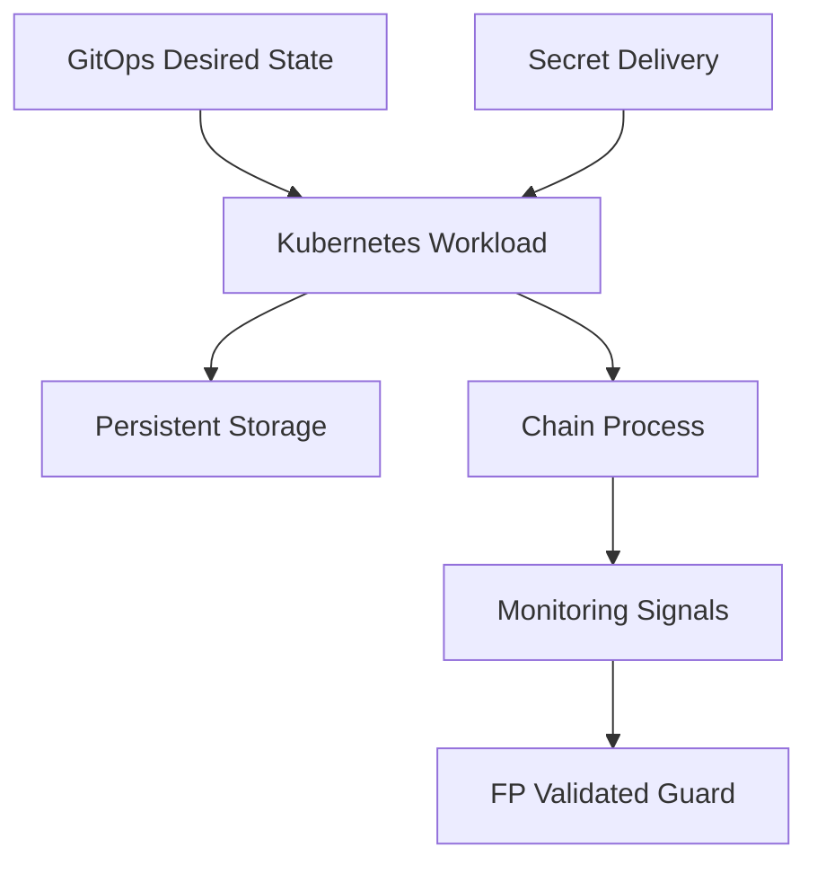

# Initia Node Architecture

The Initia node architecture is documented at the role level, not at the private server level.

## Public architecture

| Component | Responsibility |
| --- | --- |
| Chain workload | Runs the protocol client or service process. |
| Kubernetes controller | Keeps the workload scheduled, restarted, and observable. |
| Persistent storage | Stores chain data or service state according to the chain profile. |
| Secret delivery | Injects node identity, API credentials, or signer material through runtime secret controllers. |
| Monitoring | Emits node, workload, and chain-family metrics to the FP Validated monitoring stack. |
| Guard/API surface | Gives operators controlled visibility and response actions without direct server login. |

## Safety model

Initia operations prioritize active validator topology and remote signer controls. Public docs intentionally avoid exact topology, private host paths, node names, and secret paths.

## Architecture diagram

