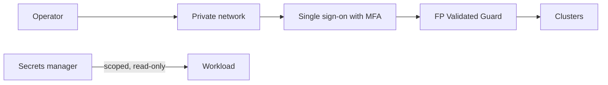

# Access and Secrets Model

People and workloads use different identities. An operator signs in as a person and is authorized by group. A workload reads its secrets as itself, and that identity cannot sign in to any management service.

## Operator access

| Principle | What it means in practice |
| --- | --- |
| No public management endpoints. | Management services are reachable only from a private network. |
| One identity per person, with MFA. | Every operator signs in through single sign-on. MFA is mandatory, and a passkey or hardware key is preferred. |
| Authorization by group. | What a person can do in each service follows from group membership. Read access and administration are separate groups. |
| Administrator access is the exception. | The administrator group is small and is meant for break-glass use. |
| Routine work goes through Guard. | Operators do not run commands against the clusters directly for day-to-day work. They use [FP Validated Guard](/fp-validated-infra/fp-validated-guard), which adds permission levels, approval for dangerous actions, secret masking, and an audit log. |
| Direct host access is a break-glass path. | It is used when the cluster itself is unavailable or a host needs repair below Kubernetes. |

## Secrets

| Principle | What it means in practice |
| --- | --- |
| One place for secrets. | Keys and credentials are stored in a central secrets manager. They are never in Git or in configuration values. |
| Delivered, not fetched by hand. | A workload receives its secrets through an automated path that authenticates as the workload's own namespace. No long-lived token is handed to a workload. |
| Scoped to one chain and network. | Each chain namespace can read its own secrets and nothing else. Access is read-only. |
| Testnet and mainnet are separate. | They use separate namespaces and separate secrets, so a testnet workload cannot pick up a mainnet key by mistake. |
| Fail closed. | A workload whose secret is missing does not start. Nothing generates a placeholder key. |
| Some keys are not readable by any single system. | Where a chain's signer supports it, the key is kept in a key management service that signs without releasing the key, or it is split so that no single place holds it whole. |

## What these docs leave out

This site does not publish:

- IP addresses and network ranges
- node names and private hostnames
- VPN configuration
- secret paths, role names, and policy contents
- recovery and bootstrap procedures for the secrets manager
- cluster credentials and their locations
- client secrets, webhook URLs, and auth headers
- the contents of any Kubernetes Secret
- addresses of private management services

## Related

- [FP Validated Guard](/fp-validated-infra/fp-validated-guard)
- [GitOps Topology](/fp-validated-infra/gitops-topology)
- [Ports and Secrets Contract](/chains/shared-kubernetes/ports-and-secrets-contract)
