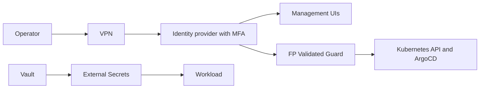

# Access and Secrets Model

People reach management services through a VPN and single sign-on. Workloads get secrets from Vault through External Secrets. The two paths use different identities. An operator signs in as a person and is authorized by group. A workload reads Vault as its own namespace's service account, and that identity cannot sign in to any management service.

## Operator access

1. The operator connects to the VPN. Management services have no public endpoint, and the management cluster's Kubernetes API is private.
2. Internal DNS resolves the management hostnames to an internal ingress.
3. The ingress sends the operator to the identity provider (Authentik). MFA is mandatory. A passkey or hardware key is the preferred method, and an authenticator app is the fallback.
4. The service authorizes the operator by group.

| Service | How access is decided |
| --- | --- |
| ArgoCD | OIDC groups mapped to ArgoCD roles. Read and sync is a separate group from administration. The local admin account is disabled. |
| Grafana | OIDC groups mapped to viewer, editor, and admin. |
| Prometheus and Alertmanager | No per-user authorization of their own, so the ingress enforces sign-in in front of them. |
| Vault | OIDC login, then Vault policy. Administrator membership needs separate approval, and admin tokens are short-lived. |
| Guard | SSO login against an allowlist of users, then Guard's own roles and levels. |

Identity provider accounts are local accounts managed by us. External identity providers are not connected. The platform-wide admin group is for break-glass use and is kept small.

## Day-to-day work goes through Guard

Operators do not use `kubectl` against the clusters for routine work. They use [FP Validated Guard](/fp-validated-infra/fp-validated-guard), which adds levels, approval for dangerous calls, Secret masking, and an audit log on top of the Kubernetes API and ArgoCD.

Direct host access over SSH is a break-glass path. It is used when the cluster API itself is unavailable or a host needs repair below Kubernetes.

## Secrets

Vault runs in the management cluster. It unseals automatically through the cloud provider's key management service, so a Vault restart does not need a person to enter unseal keys.

Workloads never talk to Vault with a long-lived token. The path is:

1. Each workload namespace has a secret store that points at Vault and a service account for External Secrets.
2. External Secrets logs in to Vault with that service account's Kubernetes token. Vault validates the token with the cluster it came from. Each cluster has its own Vault auth mount.
3. Vault maps the login to a role for that one namespace. The role's policy grants read access to an enumerated list of paths.
4. External Secrets writes the values into a Kubernetes Secret, and the pod mounts it read-only.

| Property | Effect |
| --- | --- |
| One role and one policy per chain namespace | A compromised namespace can read its own chain's secrets and nothing else. |
| Read-only policies with listed paths | A workload cannot write to Vault or browse it. |
| Separate namespaces for testnet and mainnet | Several charts refuse to render when the namespace does not contain the network name, so a testnet workload cannot mount a mainnet secret by mistake. |
| Secrets Application synced first | A workload whose secret is missing fails to start. It does not start with a generated placeholder key. |

CI rejects any manifest that reads a Vault root token.

### Secret classes

| Class | Examples |
| --- | --- |
| Validator and signer keys | Consensus key, threshold signer share, validator keystore, signer state. |
| Node identity | P2P node key. |
| Application credentials | Database password, API token, registry pull credential, webhook secret. |
| Platform secrets | OIDC client secrets, TLS material for internal services. |
| Bootstrap secrets | The few values needed before Vault exists. These are kept in a password manager, not in Vault and not in Git. |

Some signing keys are not readable by any single system. The LayerZero DVN signer uses a cloud KMS key that never leaves the KMS. Another validator key is encrypted at rest, and its decryption key is split into three shares held in three different places, two of which are needed at start.

## What these docs leave out

This site does not publish:

- IP addresses and CIDR ranges
- node names and private hostnames
- VPN peer configuration
- Vault paths, role names, and policy contents
- Vault recovery and bootstrap procedures
- kubeconfig contents and locations
- OIDC client secrets, webhook URLs, and auth headers
- rendered Kubernetes Secrets
- backend addresses of private UIs

## Related

- [FP Validated Guard](/fp-validated-infra/fp-validated-guard)
- [GitOps Topology](/fp-validated-infra/gitops-topology)
- [Ports and Secrets Contract](/chains/shared-kubernetes/ports-and-secrets-contract)
