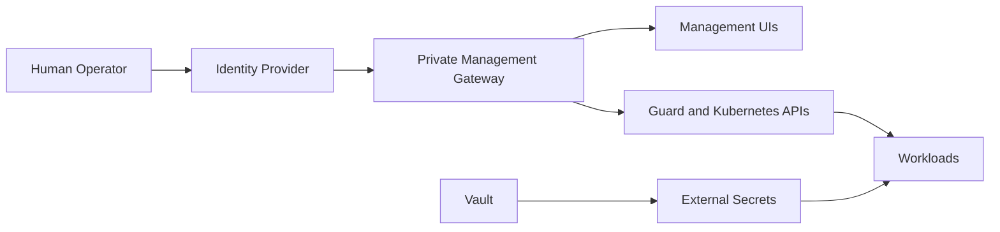

# Access and Secrets Model

The public principle is straightforward: operators access management systems through controlled identity paths, while workloads receive secrets only through scoped runtime delivery.

## Access model

Management UIs such as ArgoCD, Grafana, Prometheus, Alertmanager, Vault, Authentik-backed access flows, and platform APIs are not designed as public unauthenticated endpoints. The live platform uses:

- private or identity-aware management access paths,
- Authentik/OIDC style authentication,
- baseline RBAC that avoids default Secret read access,
- domain-separated permissions for platform, observability, access, and security roles,
- Vault + External Secrets for runtime secret delivery rather than manual secret copying.

## No routine server login

A core FP Validated operating principle is that product and operations work should be possible without direct login to production servers.

For example, a dashboard-style product deployment follows this pattern:

1. Build and validate the application outside the server.
2. Publish an immutable container image.
3. Update the desired Kubernetes deployment state.
4. Let ArgoCD/Kubernetes reconcile the rollout.
5. Verify readiness, ingress, logs, and health checks externally.

This separates authority:

| Actor | Capability |
| --- | --- |
| Developer | Propose code and image changes. |
| Platform operator | Approve deployment state and rollout. |
| Observability role | Read dashboards, alerts, and health reports. |
| Guard service | Perform scoped operational actions through API controls. |
| Secret controller | Inject secrets into workloads without exposing values to users. |

## Secrets model

Vault and External Secrets are used as the runtime secret delivery pattern. Public docs should describe secret *classes*, not secret values or exact paths.

| Secret class | Example use |
| --- | --- |
| Cluster bootstrap secret | Initial platform bootstrap and recovery. |
| Application credential | Database, webhook, or API integration credential. |
| Validator key material | Node key, signer shard, validator key, or slashing database credential. |
| TLS / ingress material | Management UI or service ingress identity. |

## Public redaction policy

Never publish:

- exact public/private IPs or CIDRs,
- node hostnames,
- VPN peer configuration,
- Vault unseal/root/bootstrap procedure details,
- Vault paths that reveal production key layout,
- kubeconfig contents or file paths,
- OIDC client secrets,
- webhook URLs or auth headers,
- rendered Kubernetes Secret payloads,
- exact backend service targets for private UIs.

## What can be public

It is safe to describe:

- that Vault + External Secrets is used,
- that identity-aware ingress protects management UIs,
- that human access is role-scoped,
- that baseline roles avoid Secret read access,
- that signing secrets fail closed when missing or inconsistent,
- that routine operations happen through GitOps, Guard, and observability surfaces rather than direct server login.
