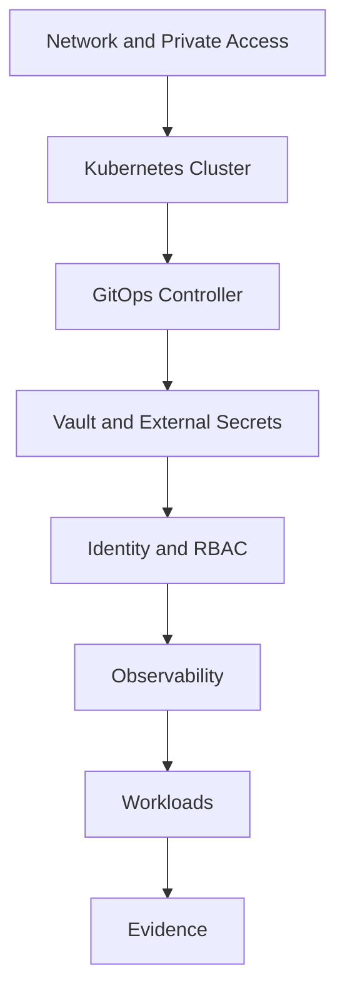

# Bootstrap and Recovery Runbook

This public runbook summarizes the gates FP Validated uses when building or recovering Kubernetes-based infrastructure.



## Bootstrap phases

1. **Network gate** — private management access and DNS/proxy assumptions are validated without publishing internal topology.
2. **Cluster gate** — base cluster comes up with minimal dependencies.
3. **GitOps gate** — ArgoCD is installed and points only at the intended app root.
4. **Secrets gate** — Vault and External Secrets are initialized through manual approval steps.
5. **Access gate** — identity-aware ingress and RBAC are validated before exposing management UIs.
6. **Observability gate** — Prometheus/Grafana/Alertmanager and node agents are deployed before production workloads are considered healthy.
7. **Workload gate** — chain and service workloads sync only after monitoring and secret delivery are proven.
8. **Evidence gate** — screenshots/logs/manifests are collected for operational proof.

## Recovery principles

- Keep management and validator planes independently recoverable.
- Rebuild management services without taking over validator workloads automatically.
- Restore secrets from approved secure processes only.
- Prefer phase-by-phase recovery over broad cluster-wide changes.
- Capture evidence before and after recovery.
- Prefer GitOps/API recovery over direct server access.
- Do not publish command transcripts that reveal private topology or credentials.

## Recovery matrix

| Failure area | First response | Recovery boundary |
| --- | --- | --- |
| Management UI unavailable | Verify private access, ingress, identity, and service health. | Do not mutate validator workloads while restoring UI access. |
| GitOps controller degraded | Freeze non-emergency deployments and restore controller health. | Avoid manual drift except documented break-glass actions. |
| Secret delivery issue | Stop affected rollout and validate External Secrets/Vault integration. | Never paste secrets into manifests or docs. |
| Observability gap | Restore exporter/scrape/dashboard pipeline. | Do not declare workload healthy without independent evidence. |
| Chain workload degraded | Follow chain-specific runbook. | Signing safety overrides availability. |
| Product workload degraded | Roll back image or manifest through ArgoCD/Kubernetes API. | No routine SSH-based patching. |

## What external readers should learn

FP Validated's recovery model is not "restart everything." It is dependency-aware:

```text
Access → GitOps → Secrets → Observability → Workloads → Evidence
```

That ordering keeps recovery auditable and reduces the chance that a management-plane issue becomes a validator safety incident.
