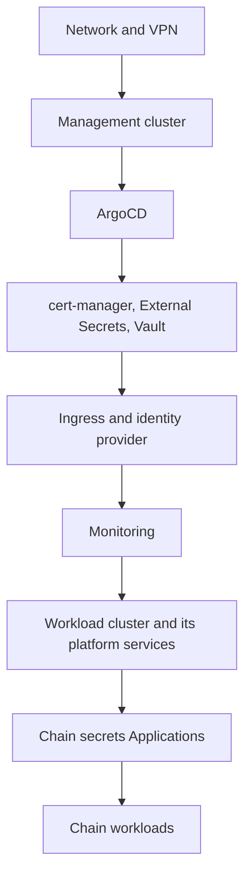

# Bootstrap and Recovery

This page gives the order in which the platform is built and the order in which it is restored. The two are the same order, because each layer depends on the ones before it. Command-level procedures are kept private.

## Bootstrap order

| Step | What is built | Ready when |
| --- | --- | --- |
| 1. Network | Virtual network, VPN gateway, internal DNS. | An operator can reach the private network. |
| 2. Management cluster | The managed Kubernetes cluster, from Terraform. | Nodes are ready and the API is reachable only privately. |
| 3. ArgoCD | ArgoCD and its root Application. | The root lists the expected child Applications. |
| 4. Secrets | cert-manager, External Secrets, Vault. Vault is initialized once and unseals through the cloud KMS after that. | The cluster secret store reports ready. |
| 5. Access | Ingress controllers, the identity provider, internal certificates. | Sign-in with MFA works for ArgoCD and Vault. |
| 6. Monitoring | Central Prometheus, Alertmanager, Grafana, rules, dashboards. | Rules are loaded and Alertmanager has its receivers. |
| 7. Workload cluster | The k3s cluster, registered with ArgoCD as a remote cluster. Then its platform Applications: storage, ingress, External Secrets, cluster Prometheus, Guard. | The cluster's metrics appear in the central Prometheus. |
| 8. Chain secrets | For each chain: namespace, secret store, ExternalSecrets. | Every ExternalSecret is synced. |
| 9. Chain workloads | Nodes first, then signers. | The node is synced to the chain head before a signer starts. |

A chain's secrets Application is synced and checked before any workload in its namespace. A validator is first deployed as a non-signing node and switched to its signing values in a separate change.

## Recovery principles

- Fix the lowest broken layer first. A workload problem that is really a secrets problem is fixed at the secrets layer.
- Restoring the management cluster does not touch chain workloads. They keep running without it, as described in the [overview](/fp-validated-infra/overview#what-happens-when-the-management-cluster-is-down).
- Recover through Git and ArgoCD where possible. A manual change made during an incident is written back to Git afterwards, or it will show up as drift.
- Chain data volumes use a retain policy. Deleting a workload or an Application does not delete its data.
- Signing safety outranks availability during recovery, the same as in normal operation.

## Recovery by failure area

| Failure | First response | Boundary |
| --- | --- | --- |
| A management UI is unreachable | Check VPN, internal DNS, ingress, and the identity provider, in that order. | Do not change workloads to get a UI back. |
| ArgoCD is degraded | Pause deployments. Workloads are unaffected. Restore ArgoCD from its Applications in Git. | No manual applies to the workload cluster except documented break-glass steps. |
| Vault is sealed or down | Running workloads keep their existing Kubernetes Secrets. Restore Vault. Auto-unseal handles a plain restart. | No rollouts that need new or rotated secrets until the secret stores report ready. |
| A secret store is not ready | Check the namespace's service account, the Vault role, and Vault reachability. | Do not copy secret values by hand into the cluster. |
| Central monitoring is down | Treat every workload as unobserved. Check chains from external sources until it is back. | Do not start risky changes while blind. |
| A workload node is lost | Non-signing workloads are redeployed on another node. For a signing workload, confirm the old instance is gone before starting it elsewhere. | One active signer per key. |
| Guard is unavailable | Critical paging still works. Use ArgoCD directly for urgent syncs. | Emergency key issuance and the kill switch are available from inside the Guard pod to an operator with host access. |
| A chain workload is degraded | Follow the chain's runbook. | Signing safety first. |

## Backups that recovery depends on

| Item | Where it lives |
| --- | --- |
| Cluster and application definitions | Git. |
| Secrets | Vault storage, with unseal through the cloud KMS. Bootstrap values are in a password manager. |
| Guard state | Daily database snapshots, with a restore check in the console. |
| Chain data | Retained volumes. A lost node is rebuilt from the chain's snapshot or state-sync source, not from our own backup. |
| Signer state | Handed over explicitly when a validator moves. |
