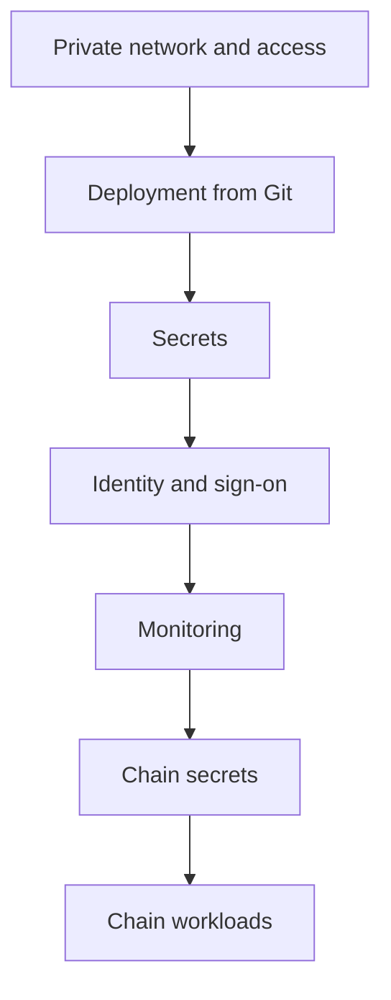

# Bootstrap and Recovery

The platform is built in layers, and it is restored in the same order, because each layer depends on the ones before it. Step-by-step procedures are kept private.

## Build order

1. Private network and operator access.
2. Deployment from Git.
3. Secrets.
4. Identity and sign-on.
5. Monitoring.
6. For each chain, its secrets.
7. Chain workloads: nodes first, then signers.

Each layer is confirmed healthy before the next one is started. A validator is first deployed as a node that does not sign, and it is switched to signing in a separate change once it has caught up with the chain.

## Recovery principles

- Fix the lowest broken layer first. A workload problem that is really a secrets problem is fixed at the secrets layer.
- Restoring control services does not touch chain workloads. They keep running without them, as described in the [overview](/fp-validated-infra/overview#when-control-services-are-unavailable).
- Recover through Git where possible. A manual change made during an incident is written back to Git afterwards.
- Chain data is retained. Removing a workload does not delete its data.
- Do not start risky changes while monitoring is down. Check chains from external sources until it is back.
- Signing safety outranks availability during recovery, the same as in normal operation. Before a signer starts in a new place, the old instance is confirmed gone.

## What recovery depends on

| Item | Where it comes from |
| --- | --- |
| Cluster and application definitions | Git. |
| Secrets | The secrets manager. The few values needed before it exists are kept separately, outside Git. |
| Chain data | Retained volumes. A lost node is rebuilt from the chain's snapshot or state sync, not from our own copy. |
| Signer state | Handed over explicitly when a validator moves, and checked against the chain before the new instance signs. |

## Related

- [FP Validated Infrastructure Overview](/fp-validated-infra/overview)
- [GitOps Topology](/fp-validated-infra/gitops-topology)
