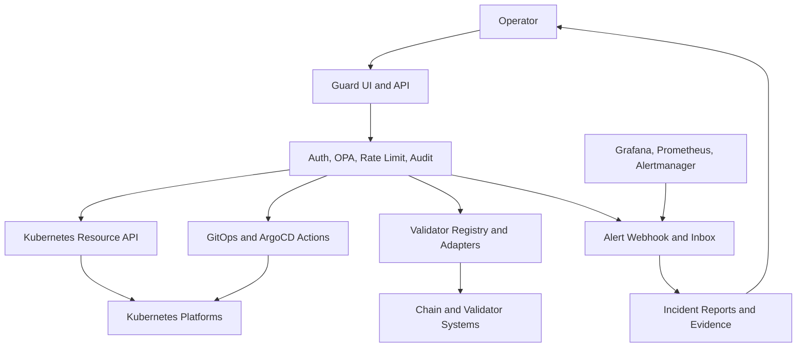
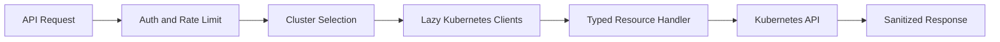
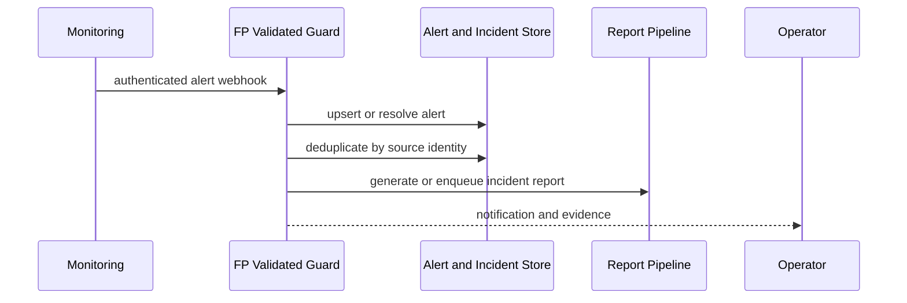

# FP Validated Guard

FP Validated Guard is the operations control layer for FP Validated's Kubernetes and validator infrastructure. It is designed so routine operations happen through authenticated APIs, GitOps, dashboards, and audited control surfaces — not by logging directly into production servers.

## What it is

From the source code, Guard is a Go API server with a web frontend and Kubernetes integration. The server initializes:

| Capability | Source-code basis | Public description |
| --- | --- | --- |
| HTTP API server | `internal/apiserver/server.go` | Echo-based API server with health, readiness, metrics, authentication, rate limiting, and route registration. |
| Kubernetes operations | `internal/kube/container.go`, `internal/kube/handlers/*` | Multi-cluster Kubernetes client container with typed handlers for Pods, Deployments, Nodes, Services, Ingresses, Events, ConfigMaps, Secrets, and apply/dry-run. |
| Validator registry | `internal/apiserver/handlers_chain_validators.go` | Stores chain/network/operator metadata and normalizes validator records across chain families. |
| Validator info adapters | `internal/apiserver/handlers_chain_validator_info*.go` | Enriches validator status through chain-specific adapters and exposes a common response model. |
| Alert intake | `internal/apiserver/handlers_alert_webhook.go` | Accepts authenticated Grafana/Alertmanager-style webhook events, deduplicates alerts, updates incident state, and triggers reports/notifications. |
| GitOps actions | `internal/apiserver/handlers_gitops.go`, `internal/apiserver/handlers_argocd.go` | Connects operational changes to GitOps and ArgoCD workflows instead of direct node mutation. |
| Deployment model | `deploy/helm/fp-validated-guard/templates/*` | Runs as a Kubernetes Deployment with service account RBAC, probes, secret references, and optional integrations. |

## Why it exists

Validator operations require both blockchain awareness and Kubernetes awareness:

- blockchain side: validator identity, chain/network, operator address, uptime, commission, status, alerts, and incident reports;
- Kubernetes side: workload health, rollouts, pod logs, events, services, ingresses, configuration, and safe apply/dry-run;
- operations side: approval, evidence, alert routing, GitOps state, and auditability.

Guard joins those surfaces into one operator layer. The intended outcome is narrower operational access: users interact with Guard, ArgoCD, monitoring, and Kubernetes APIs under scoped permissions rather than receiving broad shell access to servers.

## Source-derived feature map

| Area | What Guard exposes |
| --- | --- |
| Health and readiness | `/healthz`, `/readyz`, `/metrics`, `/api/v1/info`. |
| Core operations | missions, runs, changes, approvals, evidence, logs, policies, bootstrap jobs, reports, governance, audit trail, deployments, timeline, playbooks. |
| Kubernetes browser | resource registry, generic resource browser, namespaces, Pods, Deployments, StatefulSets, DaemonSets, Services, Ingresses, ConfigMaps, Secrets, Events. |
| Kubernetes actions | pod log streaming, batch delete for supported resources, deployment scale/restart, server-side apply and dry-run. |
| Platform integrations | ArgoCD applications, GitOps commit/apply/file access, Helm release summary, deprecation check, cluster config, observability status. |
| Chain operations | chains, chain sources, chain reports, chain validators, validator detail enrichment, upgrade channels, timeseries. |
| Alert and incident loop | alert inbox, alert history, webhook ingestion, incident reports, report generation/review, notification channels. |
| Assurance views | runtime status, command center, security posture, compliance workbench, change queue, evidence library. |

## Kubernetes operations model

Guard's Kubernetes integration is source-code based, not a screen-scraper:

The server discovers an in-cluster configuration when running inside Kubernetes and can also load configured cluster contexts. Requests select a target cluster through query parameters and route to typed handlers.

Publicly important guardrails:

- secret data should be masked by default in user-facing views;
- apply supports dry-run and a denylist for dangerous resource kinds;
- exec is disabled by default and should remain a break-glass feature;
- mutating operations should be tied to RBAC, policy, and audit trails;
- validator/signing changes should remain manual-gated even if Kubernetes actions are available.

## Alert and incident loop

The webhook source code shows Guard acting as the bridge between monitoring and response:

This loop supports public-facing incident discipline: every alert is accepted through an authenticated endpoint, normalized, deduplicated, optionally linked to an incident/report, and then made available to operators through a controlled surface.

## Validator registry and chain adapters

The chain validator source files show a registry model with fields such as chain name, network, operator address, explorer URL, LCD/RPC endpoint metadata, chain kind, denom, and decimals. Guard then enriches validator info through chain-specific adapters and returns a common model:

| Common model area | Meaning |
| --- | --- |
| Description | moniker, identity, website, security contact, details. |
| Validation | status, jailed flag, voting power, delegator shares, unbonding fields. |
| Commission | rate, max rate, max change rate, update time. |
| Uptime | windowed signing/uptime information where available. |
| Warnings | adapter-specific caveats when data is partial. |

This lets the public docs describe validator operations consistently across Cosmos-style chains, Sui, Walrus, Monad, Ethereum, Canton, and future chain adapters without exposing private endpoints.

## Security posture

Guard should be presented publicly as an internal control plane, not an internet-open admin panel.

| Control | Public explanation |
| --- | --- |
| Authentication | API requests are authenticated; webhook ingestion requires a shared secret or bearer-style secret. |
| Authorization | Kubernetes and operational actions are intended to be policy/RBAC controlled. |
| Rate limiting | API server has request rate limiting middleware. |
| Auditability | Operational flows include audit/evidence concepts and report generation. |
| Secret handling | Runtime secrets are referenced through Kubernetes/Vault-style secret delivery, not embedded in docs. |
| Least privilege direction | Users receive role-scoped Guard/ArgoCD/observability access instead of direct server login. |

## Public positioning

Use this phrasing for external audiences:

> FP Validated Guard is our operations gateway for validator infrastructure. It gives operators a controlled, auditable way to inspect Kubernetes state, follow chain-specific validator health, receive alerts, generate incident evidence, and trigger approved remediation workflows — while keeping server access and secret material separated from day-to-day operations.
