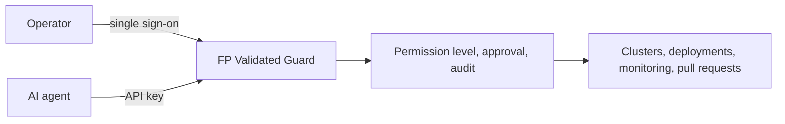

# FP Validated Guard

FP Validated Guard is our operations console. People use it through a web console, and AI agents use it through an API. Both paths run through the same checks, so a click in the console and a call from an agent are authorized, limited, and logged the same way.

Guard is reachable only from the internal network. It is not exposed to the internet.

## Why it exists

Operating validators means a small number of people, and now agents, touching systems where one wrong command can cost a delegator money. Guard puts one controlled path in front of those systems. Direct access remains for emergencies, and routine work does not use it.

## What it does

| Area | What an operator or agent can do |
| --- | --- |
| Workloads | Inspect workloads, read logs and events, restart or roll back. |
| Deployments | See the difference between Git and the cluster, and sync a workload. |
| Monitoring | Query metrics, see active alerts, and manage silences. |
| Alerts | Guard posts a card for each active alert, tracks who acknowledged it, and sends reminders. |
| Changes | Open a pull request in an infrastructure repository under the caller's own identity. Guard cannot merge. |
| Approvals | Review and approve pending changes from one inbox. |
| Chain operations | Track governance proposals on the chains we validate, cast votes, and see upcoming chain upgrades. |

## Principles

| Principle | What it means in practice |
| --- | --- |
| The same rules for people and agents. | There is no separate, looser path for automation. |
| Levels, starting at read-only. | Every caller has a level: read, operate, or administer. Each key or person gets the lowest level that does the job. |
| Dangerous actions are held. | Deleting, syncing a deployment, touching a protected area, or revealing a secret does not run on the first call. Depending on the caller, it needs a second confirmation or an approval from a human administrator. A held call changes nothing. |
| Protected areas. | System and security namespaces are off limits below the administrator level, and guarded even there. |
| Secrets are masked. | Secret values are hidden in every response. Revealing one is an administrator action that is held and logged. |
| Everything is recorded. | Every call is logged with who made it, what it was, and when. |
| One switch stops all changes. | A kill switch rejects every change from every person and key. Reading keeps working. |
| Sensitive rights are personal. | Voting on governance proposals and approving pull requests are granted to named people. An administrator role does not include them. |
| Git stays the source of truth. | Resources managed from Git are changed by pull request, not edited in the cluster. |

## Agents

- One key per agent, named so the audit log shows which agent acted.
- The lowest level that does the job. Investigation is read-only.
- Every key expires. A key that appears in a chat, a log, or a commit is revoked.
- An agent whose call is held is told that nothing was executed. It waits for the confirmation or approval. It does not retry with different arguments or look for another way to make the same change.

## Related

- [GitOps Topology](/fp-validated-infra/gitops-topology)
- [Access and Secrets Model](/fp-validated-infra/access-and-secrets)
- [Incident Response Runbook Model](/fp-validated-infra/incident-response)
