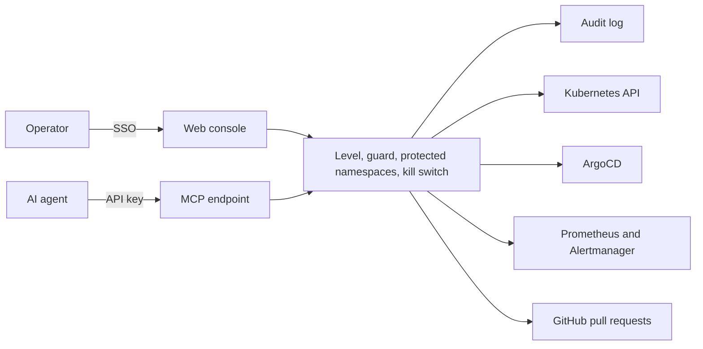

# FP Validated Guard

FP Validated Guard is the operations console for our Kubernetes clusters and ArgoCD. People use it through a web console. AI agents use it through an MCP server with an API key. Both paths run through the same checks, so a click in the console and a tool call from an agent are authorized, limited, and logged the same way.

Guard is a single service with an embedded database. It is reachable only on the internal management network, and people sign in through the identity provider. It is not exposed to the internet.

## What it does

| Area | What an operator or agent can do |
| --- | --- |
| Workloads | List and inspect Deployments, StatefulSets, and DaemonSets. Read logs and events. Restart, scale, change an image, or roll back. |
| Cluster | Inspect nodes, namespaces, and any resource kind the API server knows, including custom resources. Cordon and drain a node. |
| GitOps | List ArgoCD applications, show the diff against Git, sync, refresh, and roll back. A sync can be limited to selected resources of an application. |
| Monitoring | Query Prometheus, list active alerts, and create or expire Alertmanager silences. |
| Alerts | Post a Slack card for each active alert, track acknowledgement, and send reminders. See [Monitoring Architecture](/fp-validated-infra/monitoring-architecture#notification). |
| Git | Open a pull request in an allowed infrastructure repository under the caller's own GitHub identity. Guard cannot push to a default branch or merge. |
| Approvals | Show pull request approval requests from CI in one inbox, next to Guard's own pending approvals. |
| Infrastructure jobs | Run a script from a fixed catalog, for example to list VMs or disks. |
| Chain operations | Track governance proposals on the chains we validate and cast votes. Detect upcoming chain upgrades from upstream sources. |
| Security views | Read host OS package vulnerabilities and operator activity. Both are read-only. |

## Permission model

Every call, from the console or from an agent, carries a level. A console user has a role (`member` or `admin`) that maps to a level. An API key has exactly one level.

| Level | Allowed |
| --- | --- |
| `read` | Read resources, logs, events, metrics, and ArgoCD state. |
| `operate` | Also change workloads in namespaces that are not protected, sync ArgoCD applications, create silences, and open pull requests. No access to Secrets, RBAC, cluster-scoped resources, or protected namespaces. |
| `admin` | Also change cluster-scoped resources, protected namespaces, Secrets, and RBAC, create or delete ArgoCD applications, run infrastructure jobs, and manage keys, users, and cluster targets. |

Several controls apply on top of the level.

| Control | Behavior |
| --- | --- |
| Guard mode | Set per key. `confirm` holds a dangerous call and returns a one-time token that expires after 5 minutes. The call runs only when it is sent again with that token. `approve` holds the call until a human admin approves it in the console. An approval is valid for 15 minutes and for one use. A held call changes nothing. |
| Dangerous calls | Delete, exec, node drain, cluster-scoped changes, writes to protected namespaces, a real ArgoCD sync, application create, delete, or rollback, revealing a Secret value, creating a silence, and infrastructure jobs that change or destroy something. A dry run skips the guard. |
| Protected namespaces | System, GitOps, secret delivery, policy, monitoring, and Guard's own namespaces. `operate` cannot touch them. `admin` goes through the guard. |
| Scope limits | A key can be limited to a list of namespaces, or to named ArgoCD applications. An application-limited key can only refresh and sync those applications at their default revision. |
| Secret masking | Secret values are redacted in every response. Revealing a value is admin-only, goes through the guard, and is logged. |
| Impersonation | Guard's own service account has no permissions. Each call reaches the Kubernetes API as a group that matches the caller's level, so the API server enforces the level even if Guard has a bug. The caller's email is written to the API server audit log. |
| Kill switch | One setting rejects every change from every key and from the console. Reads keep working. |
| Audit | Every call is recorded with the caller, the tool, the arguments, and the time. |

Chain operations use separate per-user permissions. The `admin` role does not include the right to vote on governance proposals or to approve pull requests. Each is granted to a named person.

## Infrastructure jobs

Guard holds no cloud credentials. When an operator runs an infrastructure script, Guard creates a Kubernetes Job in the management cluster, and the Job runs under that cluster's workload identity.

The scripts that can run, their parameters, and whether each one reads, changes, or destroys something are defined in a catalog stored in Git. Adding or changing a script takes a reviewed pull request. A call passes only a script name and parameter values, and each value must match the pattern the catalog defines for it.

## Agents

Agents connect to the MCP endpoint with an API key. The rules for keys are:

- One key per agent, named so the audit log shows who used it.
- The lowest level that does the job. Investigation uses `read`. Routine deployment uses `operate` with `confirm`. `admin` keys use `approve`.
- Every key has an expiry date.
- A key is shown once when it is issued. A key that was pasted into a chat, a log, or a commit is revoked.

Guard serves the same operations guide to people and to agents, and the tool list in that guide is generated from the registered tools. An agent that receives a held call is told that nothing was executed and must wait for the confirmation or approval. It must not retry with different arguments or use another tool for the same change.

Resources managed by ArgoCD are changed in Git, not in the cluster. Guard's pull request tool exists for this.

## Known limits

- The guard, the masking, and the audit log are enforced by the Guard process. Kubernetes RBAC limits what that process can impersonate, but a compromised Guard pod could act at the `admin` level.
- An ArgoCD sync deploys what is in Git. Guard does not check the target namespace of an application against the protected list, so review of the Git change is the control for those namespaces.
- Guard does not hold validator signing keys and has no path to decrypt them.

## Recovery

Guard takes a daily snapshot of its database, and the console can verify that a snapshot restores. Stored cluster credentials are encrypted with a master key that is kept outside the database, so a restore needs both. If single sign-on is unavailable, an operator with host access to the cluster can issue a temporary key, revoke a key, or turn on the kill switch from inside the Guard pod.

## Related

- [GitOps Topology](/fp-validated-infra/gitops-topology)
- [Access and Secrets Model](/fp-validated-infra/access-and-secrets)
- [Incident Response Runbook Model](/fp-validated-infra/incident-response)
