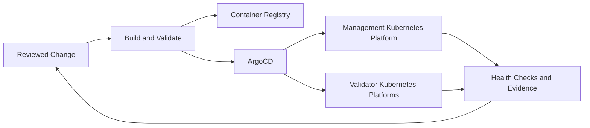
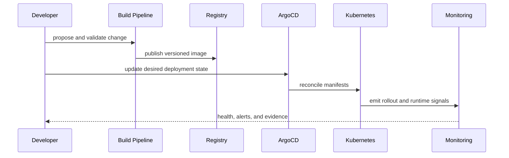

# GitOps Topology

FP Validated uses GitOps as the control surface for both the management platform and validator platforms, but the roots are intentionally separate. This is what lets us operate externally through reviewed control APIs and ArgoCD workflows instead of logging into production servers for routine changes.

## Repository and cluster boundaries

| Plane | GitOps root | Purpose |
| --- | --- | --- |
| Management plane | k3s ArgoCD app-of-apps | Platform projects, access, observability, security, and management services. |
| Service plane | k3s service app-of-apps | Foundational services such as ingress-nginx, cert-manager, Vault, External Secrets, identity/auth services, and observability. |
| Chain plane | Chain workload explicit Applications | Validator, signer, storage, and chain-specific workloads. |
| Monitoring plane | Monitoring ApplicationSet / explicit monitoring apps | Per-node observability agents, alert rules, dashboards, and routing assets. |
| Product plane | Product-specific Kubernetes manifests | Public or internal web/API apps such as FP Router, claim dashboards, docs-style sites, and related platform surfaces. |

This separation allows controlled integration without pointing a management cluster at the entire downstream app tree.

## Application waves and domains

The management plane groups ArgoCD AppProjects by domain:

- platform
- access
- observability
- security

The Kubernetes service tree independently sequences foundational services:

1. namespaces
2. certificate management
3. ingress
4. security services
5. observability services
6. platform/application services

The chain repo then deploys validator workloads as explicit Applications, each with common values and role-specific overlays.

## Externalized operations model

Our operational goal is not “SSH into a server and patch it.” Routine changes follow an externalized control path:

| Step | What happens | Why it matters |
| --- | --- | --- |
| Build | Code is validated and packaged as a container image. | Runtime artifacts are reproducible and reviewable. |
| Publish | Image is pushed to a registry under a versioned tag or digest. | The deployment target is explicit. |
| Declare | ArgoCD/Kustomize/Helm state references the intended image or values. | Desired state is visible outside the server. |
| Sync | Kubernetes reconciles the declared state. | Operators do not need direct shell access to mutate production. |
| Verify | Rollout health, service health, and logs are checked. | Deployment completion is evidence-based. |

The `fp-claim-dashboard` deployment is a good example of this model: image build, registry push, ArgoCD image override, rollout verification, and application health check are performed through Kubernetes/GitOps surfaces rather than manual edits on the node.

## Permission separation

Public-facing operational tools should be role-scoped:

- Developers can propose code and image changes.
- Platform operators can approve deployment state changes.
- Observability systems can read health and alert data.
- Guard services can execute narrowly scoped operational actions.
- Secret material is injected by runtime controllers, not copied into runbooks or dashboards.

This gives external teams enough control to deploy and diagnose without granting broad server access.

## Promotion model

A public-safe promotion model looks like this:

Automated pruning and implicit takeover are avoided for sensitive workloads. Validator/signing changes require manual gates.
