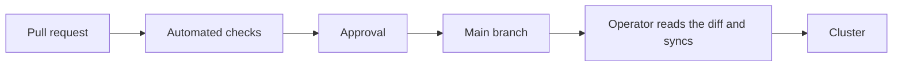

# GitOps Topology

The clusters are deployed from Git by one deployment service. The state of a cluster is changed by merging a pull request and then applying that commit to the workload it belongs to.

## Principles

- **Git is the source of truth.** What runs in a cluster is what a commit on the main branch says should run. A manual change made during an incident is written back to Git afterwards.
- **Review before merge.** Every change is a pull request with automated checks and an approval.
- **Merge is not rollout.** Sync is manual. Merging a version bump does not restart a validator. An operator chooses the time, reads the difference between Git and the cluster, and syncs one workload.
- **Nothing is removed automatically.** A resource deleted from Git stays in the cluster until someone removes it on purpose. This protects chain data and signing workloads from a mistaken deletion in a pull request.
- **Where a workload runs and how it is configured are kept apart.** The definition of which workloads exist on which cluster is in one repository. Charts and chain settings are in another. A settings change cannot add a new workload by itself.
- **Secrets come first.** For each chain, the resources that deliver its secrets are applied and checked before any of its workloads.

## Change flow

| Step | What happens |
| --- | --- |
| Propose | A pull request. Operators and agents can open one through [FP Validated Guard](/fp-validated-infra/fp-validated-guard) under their own identity. |
| Check | Automated checks validate the manifests, render the charts, test the alert rules, and reject known-unsafe patterns. |
| Approve | A reviewer approves. The approval is recorded on the pull request. |
| Merge | The change lands on the main branch. Nothing in the cluster changes yet. |
| Sync | An operator reads the diff and syncs the one workload. |
| Verify | The operator confirms the rollout, the health of the workload, and the chain's own signals such as height, peers, and signing. |

## Validators that move

A validator that is being moved between hosts is marked so that it can only be started by hand, and the change states its precondition: the old instance has stopped. The same identity must never sign from two places.

## Rollback

A rollback is the same flow with a revert commit. For an urgent case, the deployment service can return a workload to an earlier revision, and the revert is committed afterwards.

## Related

- [FP Validated Guard](/fp-validated-infra/fp-validated-guard)
- [Access and Secrets Model](/fp-validated-infra/access-and-secrets)
- [ArgoCD and Values Pattern](/chains/shared-kubernetes/argocd-and-values-pattern)
