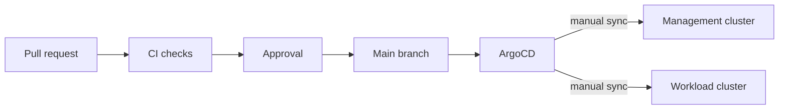

# GitOps Topology

Both clusters are deployed by one ArgoCD, which runs in the management cluster. The workload cluster is registered with it as a remote cluster and has no ArgoCD of its own. Cluster state is changed by merging a pull request and syncing the application that the change belongs to.



## Repositories

| Repository | Holds |
| --- | --- |
| Cluster repository | Terraform for the management cluster, and the ArgoCD Applications for both clusters. Also the per-chain namespace, secret store, and ExternalSecret manifests. |
| Chain repository | Helm charts for chain workloads and one values directory per chain and network. No ArgoCD Applications. |
| Monitoring repository | Alert rules, dashboards, exporters, and the static node inventory. |
| Product repositories | Charts or manifests for product services such as the staking platform and this docs site. |

Keeping the Applications in the cluster repository and the charts in the chain repository means one place answers "what is deployed where", and a chain values change cannot add a new workload by itself.

## Application roots

ArgoCD has one root per cluster.

| Root | Deploys |
| --- | --- |
| Management root | The management cluster's own services. |
| Workload root | Every Application that targets the workload cluster: platform services first, then chains and product services. |

Applications are ordered by sync wave, and the file name carries the wave number, so the directory listing reads in dependency order.

Management cluster order:

1. AppProjects and namespaces
2. cert-manager
3. External Secrets
4. Vault
5. Ingress controllers, internal and public
6. Policy engine and policies
7. Identity provider
8. Internal certificates and OIDC client secrets
9. Prometheus, Alertmanager, Grafana, and monitoring assets
10. Internal CA distribution to nodes
11. Image registry
12. Internal ingress routes
13. Product and operations services

Workload cluster order:

1. Storage driver, cluster DNS, static volumes
2. Ingress controllers and cert-manager
3. External Secrets
4. Cluster Prometheus
5. FP Validated Guard
6. Chains and product services. For each chain and network, a secrets Application comes before its workload Applications.

ArgoCD AppProjects separate platform, security, observability, and workload-cluster Applications, so an Application in one project cannot deploy into another project's namespaces or clusters.

## How a chain is declared

Each chain and network gets two kinds of Application.

| Application | Source | Creates |
| --- | --- | --- |
| Secrets | Cluster repository | The namespace, the Vault secret store for that namespace, and the ExternalSecrets. |
| Workload, one per node or role | Chain repository chart plus two values files | The StatefulSet or Deployment, its Services, and its ServiceMonitor. |

A workload Application loads the chain's common values first and the node's own values second:

```yaml
source:
  path: charts/<chart>
  helm:
    valueFiles:
      - /variables/<chain>-<network>/common-values.yaml
      - /variables/<chain>-<network>/<node>.yaml
```

The secrets Application is synced before any workload in the namespace. A Cosmos validator with a threshold signer is several Applications: one per cosigner and one for the validator. Details are in [ArgoCD and Values Pattern](/chains/shared-kubernetes/argocd-and-values-pattern).

## Sync policy

- Applications for both clusters use manual sync. ArgoCD shows drift but does not correct it.
- Pruning is off. A resource removed from Git stays in the cluster until someone deletes it on purpose.
- Syncing a root does not sync its children. Each child Application is synced separately, and a sync can be limited to selected resources.
- Applications for validators that are being moved carry a manual-only cutover annotation, and their file header states the precondition, for example that the old instance has exited.

The exception is a small set of monitoring-only Applications, such as host exporters, which sync automatically.

## Change flow

| Step | What happens |
| --- | --- |
| Propose | A pull request against the cluster, chain, or monitoring repository. Operators and agents can open it through Guard under their own GitHub identity. |
| Check | CI parses every YAML file, lints charts, runs chart render tests and rule tests, and rejects known-bad patterns such as a manifest that reads a Vault root token. |
| Approve | CI posts an approval request to Slack and to the Guard inbox. An approval there is recorded as a GitHub review on the pull request. A reviewer can also approve in GitHub directly. |
| Merge | The pull request merges to the main branch. Nothing changes in the cluster yet. |
| Sync | An operator reads the ArgoCD diff and syncs the one Application. Through Guard, a real sync is a guarded call. |
| Verify | Rollout status, pod health, and the chain's own signals: height, peers, signing. |

A rollback is the same flow with a revert commit, or an ArgoCD rollback to an earlier revision for an urgent case.

## Related

- [FP Validated Guard](/fp-validated-infra/fp-validated-guard)
- [Access and Secrets Model](/fp-validated-infra/access-and-secrets)
- [ArgoCD and Values Pattern](/chains/shared-kubernetes/argocd-and-values-pattern)
