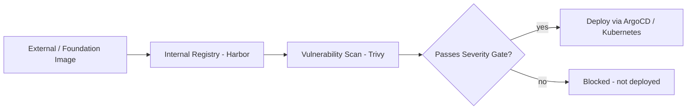

# Container Image Supply Chain

Externally provided container images — for example, foundation-provided client
images for a chain — are never deployed straight from a public or foundation
registry. Every such image is first pulled into the internal registry, scanned
for vulnerabilities, and deployed only if it passes the scan gate. An image that
fails the gate is not deployed.

## Why we mirror and scan

Pulling foundation images directly into production would put an unreviewed,
externally controlled artifact onto validator and management nodes. Routing every
image through the internal registry gives us:

| Property | What it buys us |
| --- | --- |
| Provenance | A known, versioned, internally addressed image instead of a moving upstream tag. |
| A single scan gate | One consistent vulnerability policy applied to every cluster that pulls the image. |
| Availability | Nodes pull from an internal endpoint rather than depending on an external registry at deploy time. |
| Control | We decide when a new upstream image is admitted, re-scanned, and promoted. |

All validator and management clusters pull foundation-provided images through the
same internal registry and the same scan gate, so the vulnerability policy is
enforced identically regardless of where the workload runs.

## Stages

| Stage | What happens | Why it matters |
| --- | --- | --- |
| Ingest | The external/foundation image is copied (all architectures) into an internal registry project under an explicit tag or digest. | The deployment target becomes an internal, immutable reference. |
| Scan | The registry scans the image on push and records a vulnerability report by severity. | Vulnerabilities are known before anything is scheduled. |
| Gate | The registry refuses to serve images that contain vulnerabilities at or above the configured severity threshold. | Vulnerable images cannot be pulled, so they cannot be deployed. |
| Deploy | GitOps state references the internal image; Kubernetes reconciles the rollout using a scoped pull credential. | Desired state is reviewable and no server login is required. |
| Verify | Rollout health, pod status, and pull events confirm the image was admitted and started. | Deployment completion is evidence-based. |

## Internal registry

The internal registry (Harbor) holds mirrored external images and internally
built images in private, project-scoped repositories.

- Repositories are private; anonymous pull is not permitted.
- The registry is served over TLS signed by the internal management CA. Every
  node that pulls from it must trust that CA (see
  [Node CA trust](#node-trust-prerequisite)).
- Workloads authenticate with a scoped, pull-only robot credential, delivered to
  the namespace as a registry pull secret. This is an application-credential
  secret class in the [Access and Secrets Model](/fp-validated-infra/access-and-secrets);
  its value is never committed to Git or documentation.
- Push access (mirroring new images) is a separate, higher-privilege credential
  from the pull-only credential used by workloads.

## Vulnerability scanning and the gate

The registry runs an integrated vulnerability scanner (Trivy).

- **Automatic scan on push** — a report is produced for every image as it is
  ingested, and can be re-run when the vulnerability database updates.
- **Severity classification** — findings are graded (e.g. low / medium / high /
  critical).
- **Prevent vulnerable pulls** — the project is configured to block pulls of any
  image whose findings reach or exceed a defined severity threshold. Because the
  block is enforced at the registry, it applies to every consumer of the image,
  not just one deployment.

:::warning Fail closed
If an image at or above the severity threshold is requested, the pull fails and
the workload does not start. This is the intended behaviour: a vulnerable image
is blocked rather than silently deployed.
:::

When a foundation image fails the gate, it is **not** deployed. The remediation
path is to obtain a fixed upstream image (or an updated tag/digest), re-ingest it,
and let it re-scan. A time-boxed exception is only acceptable through an explicit,
reviewed decision — never by disabling the gate in place.

## Node trust prerequisite

Because the registry is served with an internal-CA certificate, a node can only
pull from it after it trusts that CA at the container-runtime level. This is a
per-node prerequisite:

- Management-plane nodes receive the CA through a platform-managed trust
  distribution mechanism.
- k3s-based validator nodes trust the registry CA through the node container
  runtime's registry configuration.

If a node does not trust the CA, image pulls fail TLS verification before
authentication is ever attempted, which surfaces as an `x509: certificate signed
by unknown authority` pull error. The internal CA rotates on a schedule, so the
trust distribution must keep the current CA present on every node; a stale copy
will begin failing pulls after rotation.

## Deployment reference

- Deployments reference the **internal** image path, not the external/foundation
  source path.
- The pull-only robot credential is attached to the workload as its image pull
  secret.
- Because the gate lives in the registry, a passing image deploys normally and a
  failing image is blocked at pull time — no separate admission step is required
  to stop a vulnerable image.

## What this page intentionally omits

Per the [public redaction policy](/fp-validated-infra/access-and-secrets#public-redaction-policy),
this page does not include registry hostnames or IPs, robot account names, secret
manager paths, or rendered credential payloads. It describes the architecture and
policy, not the private endpoints or secret values.

## Related

- [GitOps Topology](/fp-validated-infra/gitops-topology)
- [Access and Secrets Model](/fp-validated-infra/access-and-secrets)
- [Security Standards](/operations/security-standards)
