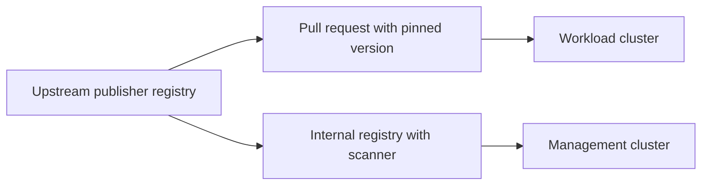

# Container Image Supply Chain

Every image that runs in the clusters is named in Git at a fixed version, and a version changes only through a reviewed pull request. On top of that, the management cluster has an internal registry that scans images for known vulnerabilities.

The two clusters are at different stages. This page says which control applies where.

## Version pinning

| Rule | Where it is enforced |
| --- | --- |
| Deployed values reference an image by an explicit version tag or a digest, not by a floating tag such as `latest`. | Review, and an admission policy on the management cluster. |
| Charts for the most sensitive signers accept only a digest. A tag is rejected at render time. | The chart itself. |
| A new client version is a values change in the chain repository. It is reviewed, merged, and then synced by an operator. | [GitOps Topology](/fp-validated-infra/gitops-topology). |
| Chain upgrades that swap a binary at a set height are declared as upgrade plans in the chain's values file, with the binary's source. Binaries downloaded outside an image carry a checksum taken from the publisher's release. | The chain's values file. |

Because sync is manual, merging a version bump does not restart a validator. The operator chooses when.

## Where images come from

Chain client images in the workload cluster are pulled from the publisher's own registry: the client team's GitHub Container Registry or Docker Hub organization, or the vendor's registry. Images we build ourselves, such as Guard and product services, are pulled from our private registry namespace with a pull credential that External Secrets delivers from Vault.

The workload cluster does not currently pull chain client images through the internal registry. The internal registry serves the management cluster.

## Internal registry

The management cluster runs Harbor with the Trivy scanner.

- Repositories are private. Anonymous pull is off.
- Pushed images are scanned for known CVEs.
- A workload pulls with a robot credential that is delivered to its namespace as a pull secret.
- The registry is served with a certificate from the internal CA. Management cluster nodes receive that CA through a trust distribution service, so the container runtime can pull from it.
- A CI runner inside the management network mirrors selected upstream images into the registry, because the registry is not reachable from outside.

## Admission policies

The management cluster runs Kyverno with these baseline policies:

| Policy | Checks |
| --- | --- |
| Allowed registries | Images come from the internal registry. |
| No floating tag | Images carry an explicit tag. |
| Non-root | Containers do not run as root. |
| No default namespace | Workloads are not created in `default`. |

These four run in audit mode: a violation is reported and does not block the workload. A policy moves to enforce mode per namespace once its audit results are clean.

One policy runs in enforce mode. Jobs that Guard starts for infrastructure scripts must use one specific image digest and one entrypoint, and only the cluster's own controllers may create them. A Job that does not match is rejected.

The workload cluster does not run an admission policy engine. Its controls are version pinning in Git, chart render guards, and review.

## Related

- [GitOps Topology](/fp-validated-infra/gitops-topology)
- [Access and Secrets Model](/fp-validated-infra/access-and-secrets)
- [Security Standards](/operations/security-standards)
