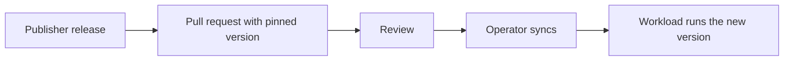

# Container Image Supply Chain

Every image that runs in the clusters is named in Git at a fixed version, and a version changes only through a reviewed pull request.

## Principles

| Principle | What it means in practice |
| --- | --- |
| Versions are pinned. | A workload references an image by an explicit version or a digest. Floating tags such as `latest` are not deployed. The most sensitive signers accept only a digest. |
| A version changes through review. | A new client version is a pull request that is reviewed before it merges. |
| The operator chooses the time. | Merging a version change does not restart anything. The operator applies it when the chain and the validator are in a safe state. |
| Images come from known sources. | Chain client images come from the client team's official registry. Images we build ourselves come from our private registry. |
| Binaries are verified. | A binary downloaded outside an image carries a checksum taken from the publisher's release. |
| Chain upgrades are declared ahead of time. | An upgrade that swaps a binary at a set height is written down with its source before the height is reached. |
| Images are scanned. | An internal registry scans the images it hosts for known vulnerabilities. |
| Policy is enforced step by step. | Cluster policies on image sources and tags start in report-only mode and move to enforcement once their results are clean. |

Version pinning and review apply to every workload. Registry scanning and cluster policy cover the control services first and are being extended from there.

## Related

- [GitOps Topology](/fp-validated-infra/gitops-topology)
- [Security Standards](/operations/security-standards)
