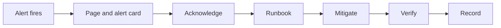

# Incident Response Runbook Model

This page describes how an alert becomes an incident and what an operator does at each step. Response time targets and the slashing policy are in [Responsiveness and Slashing Policy](/fp-validated-infra/responsiveness-and-slashing-policy). Roles and communication during an incident are in [Operations: Incident Response](/operations/incident-response).

## From alert to operator

1. An alert fires. Critical alerts page the on-call operator, and every alert appears as a card in chat.
2. An operator acknowledges it. Alerts that stay active are reminded.
3. The alert links to its runbook and its dashboard.

The paging path and the chat path are independent, so the loss of one does not hide an incident.

## Triage phases

| Phase | Goal |
| --- | --- |
| Detect | Confirm the signal is real and not a monitoring gap. |
| Classify | Find the blast radius: one workload, one host, one chain, or the control services. |
| Stabilize | Reduce risk before restoring service. For a signing workload this can mean stopping it. |
| Recover | Restore service through the normal change path where time allows. |
| Verify | Show recovery from more than one angle: the alert resolved, the chain advancing, and signing seen from an external source. |
| Record | Leave a timeline and follow-ups. |

## Rules for signing workloads

- Signing safety comes before uptime. A validator that is down loses rewards. A validator that double-signs is slashed.
- If it is unclear which instance holds the active key, stop signing and investigate. Do not start a second instance to restore liveness.
- There is no automatic failover for signing roles. Starting a signer on another host is a reviewed change that begins with proof that the old instance has exited.
- A missing or mismatched signer secret is an incident, not a warning.

## Alert categories

| Category | First checks |
| --- | --- |
| Chain liveness | Height against a public reference, peer count, client logs. |
| Signing | Missed blocks or attestations, the signer process, slashing protection, clock skew. |
| Host | Disk, memory, and whether the host is reachable. |
| Target missing | Whether the workload is gone, moved, or only its metrics are missing. |
| Secrets | Whether the workload's secret source is ready. |
| Monitoring | Whether metrics are still being collected and delivered. |

## Related

- [Monitoring Architecture](/fp-validated-infra/monitoring-architecture)
- [FP Validated Guard](/fp-validated-infra/fp-validated-guard)
- [Alert Control Runbook](/operations/alert-control-runbook)
