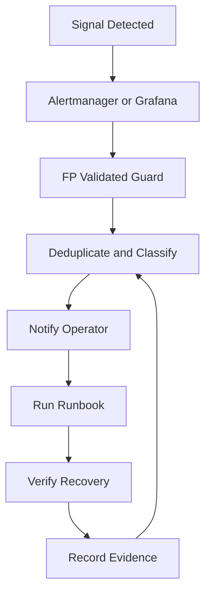

# Incident Response Runbook Model

This is the public version of the FP Validated incident loop. It describes the operating model without exposing private endpoints or command-level recovery details.



## Incident loop

```text
Signal detected
  → Alertmanager / Grafana webhook
  → FP Validated Guard ingestion
  → deduplication and state update
  → incident/report pipeline
  → operator notification
  → runbook execution
  → evidence and postmortem notes
```

## Triage phases

| Phase | Goal | Examples | External control surface |
| --- | --- | --- | --- |
| Detect | Confirm the signal is real | exporter down, chain stall, peer loss, API degradation | dashboard, alert, Guard event |
| Classify | Determine blast radius | one node, one chain, one cluster, management plane, external dependency | labels, chain matrix, deployment history |
| Stabilize | Reduce risk | stop unsafe signing, isolate bad endpoint, pause rollout, preserve evidence | ArgoCD, Kubernetes API, Guard action |
| Recover | Restore service safely | restart non-signing service, resync workload, fail back to known-good deployment, restore from approved backup | runbook-controlled Kubernetes/GitOps operation |
| Verify | Prove recovery | dashboard green, alert resolved, chain height progressing, peers healthy, no double-sign risk | Prometheus, Grafana, chain RPC, Guard report |
| Record | Preserve learning | incident report, timeline, action items, rule/runbook updates | evidence store and docs update |

## Validator-specific guardrails

- Signing safety beats uptime.
- Ambiguous active validator state means stop and investigate.
- Do not auto-failover signing roles without an explicit runbook.
- Secret or signer mismatch is a critical incident.
- Recovery evidence must include both Kubernetes state and chain-level behavior.

## Serverless-for-operators principle

Operators should not need routine SSH access to production nodes. Normal incident handling should happen through separated, auditable surfaces:

| Need | Preferred surface |
| --- | --- |
| Check health | Grafana, Prometheus, Guard health endpoint. |
| Inspect deployment state | ArgoCD and Kubernetes API with scoped RBAC. |
| Roll back a web/service workload | ArgoCD image or manifest rollback. |
| Restart a non-signing workload | Guard/Kubernetes action with audit trail. |
| Investigate chain status | Chain-specific dashboard and RPC/API checks. |
| Handle signer ambiguity | Stop and escalate through validator runbook; avoid automated recovery. |

Direct server access is a break-glass path, not the default operating model.

## Public alert categories

| Category | Typical response |
| --- | --- |
| Availability | Check pod/node/exporter/service health. |
| Chain liveness | Verify height, peers, consensus status, and upstream RPC. |
| Signing safety | Freeze automation and validate signer topology. |
| Performance | Inspect resource pressure, disk, network, and backlog. |
| Observability quality | Repair missing labels, scrape targets, or pipeline drop events. |
| Security/access | Rotate affected credentials and review access logs through private systems. |
