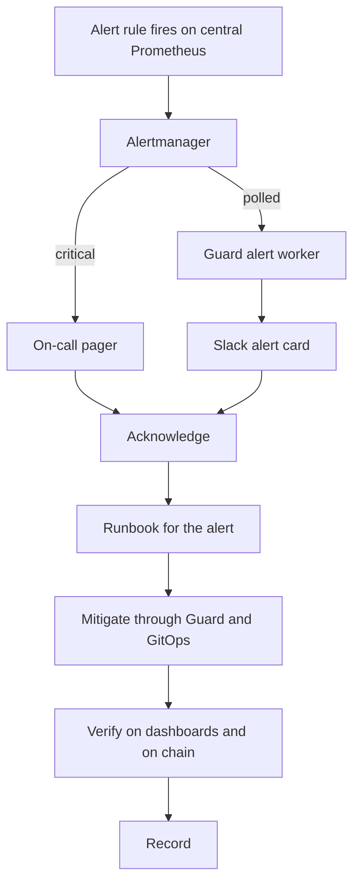

# Incident Response Runbook Model

This page describes how an alert becomes an incident and which tools an operator uses at each step. Response time targets and the slashing policy are in [Responsiveness and Slashing Policy](/fp-validated-infra/responsiveness-and-slashing-policy). Roles and communication during an incident are in [Operations: Incident Response](/operations/incident-response).

## From alert to operator

1. A rule fires on the central Prometheus. Only targets labelled `alert="on"` can fire.
2. Alertmanager sends critical alerts to the on-call pager.
3. Guard polls Alertmanager and posts a Slack card for every active alert, critical or warning. The card shows the target, the start time, the observed value, and the threshold, and links to Grafana, Prometheus, and the silence screen.
4. An operator acknowledges on the card. Guard tracks the acknowledgement and posts reminder cards for alerts that stay active.
5. Each alert carries a runbook link and a dashboard link. CI does not accept a new alert without them.

The paging path and the Slack path are independent. If Guard is down, critical alerts still page. If Guard stops polling or a Slack delivery fails, that is itself a critical alert.

## Triage phases

| Phase | Goal | Tools |
| --- | --- | --- |
| Detect | Confirm the signal is real and not a monitoring gap. | Alert card, Grafana, Prometheus query. |
| Classify | Find the blast radius: one target, one node, one chain, one cluster, or the management plane. | Inventory labels on the alert (`chain`, `network`, `node`, `component`), recent syncs in ArgoCD. |
| Stabilize | Reduce risk before restoring service. | Stop a signer, pause a rollout, turn on Guard's kill switch if a key or agent is misbehaving. |
| Recover | Restore service through the normal change path where time allows. | Revert commit and sync, ArgoCD rollback, workload restart through Guard. |
| Verify | Show recovery from more than one angle. | Alert resolved, chain height advancing, peers healthy, signing or attesting seen from an external source. |
| Record | Leave a timeline and follow-ups. | Guard's audit log, the pull requests, and a written incident note. |

## Rules for signing workloads

- Signing safety comes before uptime. A validator that is down loses rewards. A validator that double-signs is slashed.
- If it is unclear which instance holds the active key, stop signing and investigate. Do not start a second instance to restore liveness.
- There is no automatic failover for signing roles. Starting a signer on another host is a reviewed change that begins with proof that the old instance has exited.
- A missing or mismatched signer secret is an incident, not a warning.
- When a Cosmos validator moves, its last signed state is handed over explicitly and checked against the chain height before the new instance signs.

## Which tool for which need

| Need | Tool |
| --- | --- |
| Is it down, and since when | Slack card, Grafana, Prometheus through Guard. |
| What changed recently | ArgoCD history and Guard's audit log. |
| Pod state, events, logs | Guard, at `read` level. |
| Restart or scale a non-signing workload | Guard, at `operate` level. |
| Roll back a deployment | Revert in Git and sync. ArgoCD rollback for urgent cases, which is a guarded call. |
| Stop alerts during repair | The alert switch in Git. A silence through Guard when that is too slow. See [Alert Control Runbook](/operations/alert-control-runbook). |
| Host-level repair | SSH as a break-glass path. |

## Alert categories

| Category | First checks |
| --- | --- |
| Chain liveness | Height against a public reference, peer count, client logs. |
| Signing | Missed blocks or attestations, signer process, slashing-protection database, clock skew. |
| Host | Disk space and disk I/O, memory, node exporter reachability. |
| Target missing | Whether the workload is gone, moved, or only its scrape is broken. |
| Secrets | Secret store status in the namespace, Vault reachability. |
| Monitoring plane | Whether the cluster Prometheus is forwarding and the central one is receiving. |
