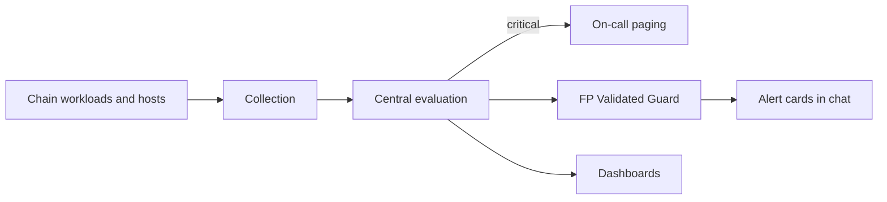

# Monitoring Architecture

Metrics are collected next to the workloads and evaluated in one place. Alert rules, alert routing, and dashboards live with the control services, so there is a single answer to "what is firing" and a single set of rules to review.

## Principles

| Principle | What it means in practice |
| --- | --- |
| Use the chain's own metrics. | We read the metrics each chain client already exposes, under their original names, so a rule can be checked against the client's documentation. |
| Look from the outside as well. | Internal metrics are compared with external views: public reference heights, reachability of our public ports from more than one location, and validator duty status seen from public sources. |
| Alerting is opt-in and decided in Git. | A target alerts only when it has been switched on in its own configuration. A target that is being built or retired is still visible on dashboards but cannot page anyone. |
| An alert must be actionable. | A page means someone has to act now. Everything else is a notification or a dashboard. |
| No alert without a runbook. | A new alert is accepted only with a severity, a description, a runbook link, and a dashboard link. Rules are tested automatically before they merge. |
| The monitoring system is monitored. | Loss of collection or of alert delivery raises its own alert. |
| Dashboards are code. | Dashboards are stored in Git and reviewed like any other change. |

## What we watch

| Area | Examples |
| --- | --- |
| Chain liveness | Height advancing, lag against a public reference, peer count. |
| Signing | Missed blocks or attestations, slashing-protection health, clock skew on signing nodes. |
| External view | A validator we operate is not performing its duties according to a public source. A public port is unreachable. |
| RPC | Head stalled, or our height behind a public reference. |
| Hosts | Disk, memory, and a node disappearing. |
| Secrets delivery | A workload's secret source is not ready. |

## Notification

- Critical alerts page the on-call operator directly. This path does not depend on Guard.
- [FP Validated Guard](/fp-validated-infra/fp-validated-guard) posts a card in chat for each active alert with the target, the start time, the observed value, and the threshold. Operators acknowledge on the card, and Guard sends reminders for alerts that stay active.
- A silence is the exception. It needs a reason and an end time, and it is recorded under the name of the person who asked for it. Planned maintenance is handled by switching the target's alerts off in Git.

## Related

- [Alert Control Runbook](/operations/alert-control-runbook)
- [Monitoring Standards](/operations/monitoring-standards)
- [Incident Response Runbook Model](/fp-validated-infra/incident-response)
