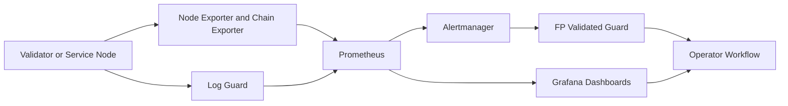

# Monitoring Architecture

FP Validated monitoring is built around a repeatable node-agent pattern and a chain-aware alert taxonomy. The goal is to see infrastructure, Kubernetes, and chain health from outside the server, through controlled observability systems.

## Node observability unit

Each monitored node can receive a standard observability bundle:

| Component | Purpose | Public-safe signal examples |
| --- | --- | --- |
| node-exporter | Host and node resource metrics. | CPU, memory, disk pressure, network saturation. |
| chain-exporter | Chain/runtime-specific metrics normalized for validator dashboards. | height progression, peers, consensus state, chain family labels. |
| log-guard | Log-based guardrail signals and pipeline health. | dropped records, error bursts, process-level health signals. |

The monitoring repo uses per-node values and an ArgoCD ApplicationSet so onboarding a node is a declarative change, not manual dashboard wiring.

## Alert rule organization

Alert rules are organized by scope:

| Scope | Examples | Action style |
| --- | --- | --- |
| Common/platform | exporter down, targets missing, labels missing, dropped records. | Restore observability or node health first. |
| Chain-specific | block stall, peer degradation, consensus stress, mempool backlog, storage-node health. | Follow the chain family runbook. |
| Security/guardrail | unexpected access path, secret delivery issue, signer mismatch indicator. | Freeze risky automation and escalate. |
| Bundle | deployable PrometheusRule packages combining common and chain rules. | Version and promote through GitOps. |

Alert labels carry dimensions such as severity, service, category, family, chain, and network. This enables routing and public status summaries without exposing internals.

## Dashboard strategy

Dashboards are layered:

1. FP Validated overview.
2. Validator overview.
3. Chain detail dashboards.
4. Kubernetes cluster health dashboards.
5. Node resource dashboards.

Datasources are templated so dashboards can move between environments. Managed dashboards are kept in Git; manual edits are governed so GitOps does not unexpectedly overwrite operator changes.

## What operators can do without server access

Operators should be able to answer these questions from the external observability layer:

- Is the node reachable and exporting metrics?
- Is Kubernetes scheduling and restarting workloads normally?
- Is the chain progressing in height?
- Are peers or consensus health degraded?
- Did a recent deployment correlate with new alerts?
- Is an incident already deduplicated and tracked by Guard?

If the answer requires direct server shell access, the runbook should either add an observability signal or document a controlled break-glass path.
