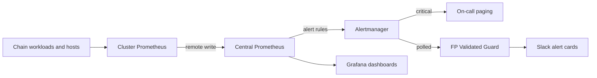

# Monitoring Architecture

Metrics are collected in each cluster and evaluated in one place. Every cluster runs its own Prometheus, which scrapes local targets and forwards the raw series to a central Prometheus in the management cluster. Alert rules run only on the central Prometheus, and Alertmanager runs next to it.

## Collection

| Source | How it is collected |
| --- | --- |
| Host metrics | A node-exporter DaemonSet on every node. |
| Chain metrics | The metrics endpoint each chain client already exposes, scraped through a ServiceMonitor that ships with the workload's Helm chart. No exporter sits in between to rename chain metrics. |
| Kubernetes metrics | kube-state-metrics and the kubelet, from kube-prometheus-stack. |
| External checks | Reachability probes against public P2P ports from two sites, an exporter that reads validator duty status from a public beacon API, and an exporter that reads public reference block heights so node height can be compared with the network. |

Every chain series carries five inventory labels: `chain`, `network`, `node`, `workload_role`, and `component`. Rules and dashboards select on these labels, not on pod names, so a workload can move between nodes without rule changes.

The cluster Prometheus is a forwarder. It keeps a short local history and has no rules, no Alertmanager, and no Grafana of its own. A denylist keeps a few high-cardinality metric families out of the forwarded stream, and CI fails when a rule or dashboard reads a metric on that list.

No log shipping agent is deployed. Logs are read on demand through the Kubernetes API, normally through [FP Validated Guard](/fp-validated-infra/fp-validated-guard).

## Alert eligibility

Whether a target can alert is decided when it is scraped, not in Alertmanager. A target that should alert gets the label `alert="on"`. Rules select that label explicitly, so a target without it is still scraped and still visible on dashboards, but it cannot fire.

The switch lives in Git next to the target:

- For workloads in the workload cluster, it is a value on the workload's ServiceMonitor.
- For hosts tracked in the static node inventory, it is a field in that node's values file.

Node-down detection uses a separate label, `node_down_alert="on"`, so turning off host metric alerts for a node does not turn off detection of the node disappearing. The [Alert Control Runbook](/operations/alert-control-runbook) shows the fields.

## Rules

Rules are PrometheusRule objects kept in the monitoring repository and synced by ArgoCD. They are grouped by what they watch:

| Group | Examples |
| --- | --- |
| Chain families | Cosmos SDK chains (missed blocks, signing stalled, slashed), Ethereum (beacon or execution head stalled, validator client without attesters, SSV duties stalled), Sui, Aptos, Walrus, Stacks, and others. |
| Signing safety | Slashing-protection database unavailable, slashing protection triggered, clock skew on a signing node. |
| External view | A validator we operate is not attesting according to a public beacon API. A public P2P port is unreachable from every probe site. |
| RPC | Head stalled, or our height lags the public reference. |
| Infrastructure | Node exporter down, disk saturation, an expected chain target missing, secret store not ready. |
| Monitoring plane | A cluster Prometheus stopped forwarding, a cluster's metrics are missing centrally, Guard stopped polling Alertmanager, a Slack delivery failed. |

CI runs `promtool check rules` and rule unit tests on every pull request. A new or changed alert must have a severity, a summary, a description, a runbook link, and a dashboard link, or the check fails.

## Notification

- Critical alerts go from Alertmanager to the on-call pager. This path does not depend on Guard.
- Slack cards come from Guard, not from an Alertmanager receiver. A Guard worker polls Alertmanager for active alerts and posts one card per alert with the target, the time it started, the observed value, and the threshold. The card has buttons to acknowledge, to open a silence in Guard, and to open Grafana or Prometheus.
- A silence is created through Guard. It needs at least one exact matcher, a reason, and an end time, and it is recorded under the requester's identity.
- Grafana is used for dashboards only. Grafana alerting, contact points, and notification policies are not used.

For planned maintenance, change the alert switch in Git. Silences are for cases where that path is too slow.

## Dashboards

Dashboards are stored in Git as ConfigMaps and loaded by the Grafana sidecar. They are grouped into folders for the management cluster, validators (one detail dashboard per chain), RPC nodes, and security. Each dashboard takes its datasource from a variable, and CI rejects a dashboard with a hardcoded datasource ID.

## Related

- [Alert Control Runbook](/operations/alert-control-runbook)
- [Monitoring Standards](/operations/monitoring-standards)
- [Incident Response Runbook Model](/fp-validated-infra/incident-response)
