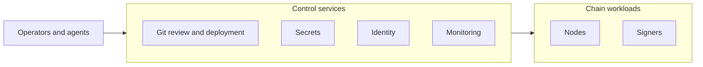

# FP Validated Infrastructure Overview

FP Validated runs validators, signers, and nodes on Kubernetes. This section explains the principles the platform is built on and the standards we hold it to. It is not a map of the deployment: addresses, hostnames, component layouts, and procedures are left out on purpose. The list of what is left out is in the [redaction policy](/fp-validated-infra/access-and-secrets#what-these-docs-leave-out).

## Principles

| Principle | What it means in practice |
| --- | --- |
| Control services are separate from chain workloads. | The services that deploy, hold secrets, authenticate people, and evaluate alerts run apart from nodes and signers. Maintenance or a fault on the control side does not stop a validator from signing. |
| Every change goes through Git. | The desired state of the platform is in Git. A change is a reviewed pull request, not a command typed against a cluster. |
| A person decides when a change takes effect. | Merging a change does not roll it out. An operator reads the difference and applies it to the one workload that should change. Nothing is deleted automatically. |
| One active signer per key. | Signing roles have no automatic failover. If it is unclear which instance is signing, the answer is to stop signing and investigate. |
| Signing safety comes before uptime. | A validator that is down loses rewards. A validator that double-signs is slashed. When the two conflict, we accept downtime. |
| Secrets stay in the secrets manager. | Keys and credentials are never in Git, in configuration values, or in these docs. A workload receives only the secrets of its own chain and network. |
| Least privilege, for people, agents, and workloads. | Access starts at read-only. Each step up is granted to a named person or key, and dangerous actions need a second confirmation or a human approval. |
| An alert must be actionable. | An alert pages only when someone has to act now, and every alert comes with a runbook and a dashboard. |
| Destructive work needs explicit approval. | Deleting data, a namespace, or a node is approved for that specific action, every time. |

## Where each topic is described

| Topic | Page |
| --- | --- |
| How a change reaches a cluster | [GitOps Topology](/fp-validated-infra/gitops-topology) |
| How people and workloads are authenticated, and how secrets are delivered | [Access and Secrets Model](/fp-validated-infra/access-and-secrets) |
| The operations console used by people and AI agents | [FP Validated Guard](/fp-validated-infra/fp-validated-guard) |
| Metrics, alerts, and notification | [Monitoring Architecture](/fp-validated-infra/monitoring-architecture) |
| Where container images come from and how versions change | [Container Image Supply Chain](/fp-validated-infra/image-supply-chain) |
| How an alert becomes an incident | [Incident Response Runbook Model](/fp-validated-infra/incident-response) |
| Build order and recovery order | [Bootstrap and Recovery](/fp-validated-infra/bootstrap-and-recovery) |
| Response targets and slashing policy | [Responsiveness and Slashing Policy](/fp-validated-infra/responsiveness-and-slashing-policy) |

## When control services are unavailable

Chain workloads keep running. A validator already holds what it needs to produce blocks and sign, and it makes no call to the control services to do so.

What stops is change and visibility. Nothing can be deployed, secrets are not refreshed, and alert evaluation pauses until the control services are back. During that time we check chains from external sources and do not start risky changes.
