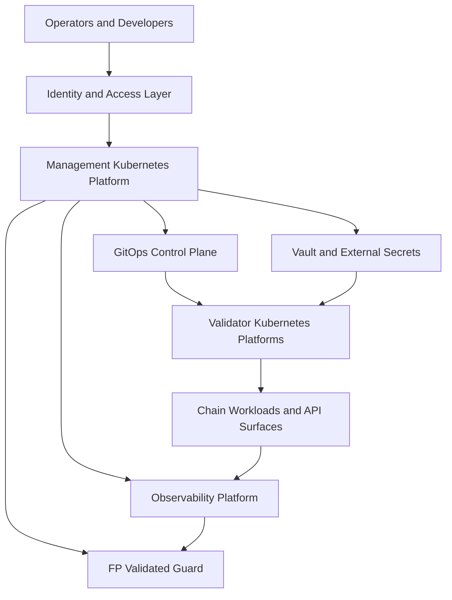

# FP Validated Infrastructure Overview

FP Validated operates blockchain infrastructure as an institution-grade Kubernetes platform, not as a collection of one-off nodes. The public model is simple:

This page intentionally describes architecture patterns, not exploitable implementation details. We do not publish exact IPs, private hostnames, VPN peer configuration, Vault paths, kubeconfigs, token names, or runbook commands that could increase operational risk.

## Platform layers

| Layer | Responsibility | Public-safe implementation pattern |
| --- | --- | --- |
| Management cluster | Central platform services and operator access | k3s-based control plane with ArgoCD, ingress-nginx, Vault/External Secrets, identity-protected management UIs, observability access, and platform AppProjects. |
| Validator Kubernetes platforms | Chain nodes and chain-specific runtime | Kubernetes runtime for validator, signer, and storage workloads with independent GitOps roots and explicit application boundaries. |
| Chain deployment repos | Per-chain values, overlays, signer topology | `common-values.yaml` plus role/node overlays, rendered through Helm and ArgoCD Applications. |
| Guard API | Operational API and incident intake | FP Validated Guard exposes health, incident/reporting, validator metadata, and controlled Kubernetes operations. |
| Product services | Public or internal app surfaces | Product namespaces currently include public-safe service classes such as FP Router and claim/dashboard-style applications, deployed through Kubernetes manifests and GitOps state. |

Public-safe live snapshot: the current management plane includes access, ingress, secret delivery, observability, platform API, routing, and Guard domains. We describe component classes and control boundaries publicly; private endpoints, node mapping, and secret layout stay omitted.
## Why split management and validator planes?

The management plane should help operate validator infrastructure, but it should not become a single blast radius for validator signing. FP Validated therefore treats management and validator Kubernetes platforms as separate planes:

- The management platform owns management services and operator workflow.
- Validator Kubernetes platforms remain the runtime for chain workloads.
- Validator platforms keep their own GitOps roots and can remain operational while the management plane is paused or rebuilt.
- Migration between planes is phase-gated; validator workloads are not moved implicitly.

## Public architecture principles

1. **GitOps first** — cluster state is described in repositories, rendered through ArgoCD, and promoted through explicit Applications.
2. **Separation of concerns** — platform, access, observability, security, and chain workloads are separated by project/domain.
3. **Secrets never live in docs or manifests** — Vault and External Secrets deliver runtime secrets; public docs describe classes of secrets only.
4. **Private management access** — dashboards and control UIs are protected behind identity-aware access paths.
5. **Fail closed on signing safety** — ambiguous validator or signer state results in no signing, not risky failover.
6. **Observable by design** — nodes ship metrics/log signals through a standard agent pattern before becoming production workloads.
