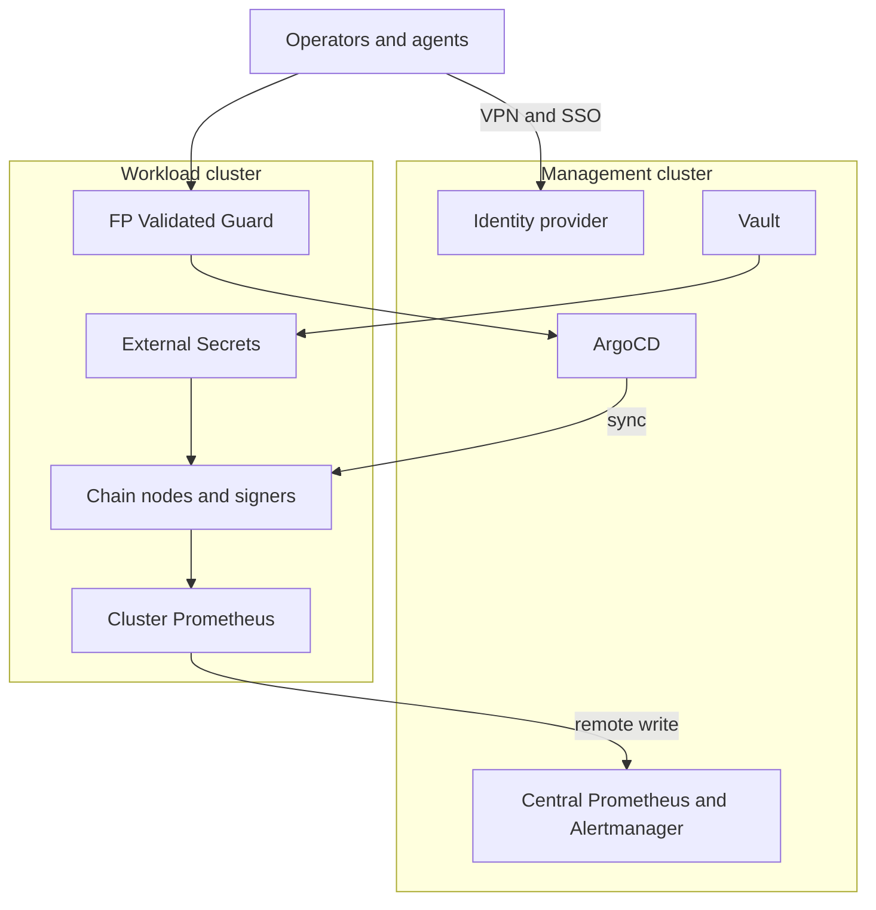

# FP Validated Infrastructure Overview

FP Validated runs on two Kubernetes clusters with different jobs. A management cluster holds the control services: GitOps, secrets, identity, the internal image registry, and central monitoring. A workload cluster runs the chain nodes, signers, and product services. The management cluster deploys to the workload cluster. Nothing in the workload cluster deploys to the management cluster.

This section describes how the platform is built. It leaves out IP addresses, private hostnames, node names, VPN configuration, Vault paths, and credentials. The full list is in the [redaction policy](/fp-validated-infra/access-and-secrets#what-these-docs-leave-out).

## The two clusters

| | Management cluster | Workload cluster |
| --- | --- | --- |
| Kubernetes | Managed Kubernetes service with a private API endpoint. | k3s. |
| Runs | ArgoCD, Vault, External Secrets, the identity provider (Authentik), the internal registry (Harbor), the policy engine (Kyverno), cert-manager, ingress, central Prometheus, Alertmanager, and Grafana. | Chain nodes, validators, signers, storage nodes, FP Validated Guard, and product services such as this docs site, the staking platform, and the RPC gateway. |
| Does not run | Chain nodes or validators. | Its own ArgoCD, Vault, Alertmanager, or Grafana. |
| Nodes | One provider, one region. | Several providers and regions, joined into one cluster over an encrypted overlay network. |
| Storage | Dynamic volumes from the provider. | Statically defined volumes with a retain policy. A chain's data stays on a named volume or a named host. |

A signing workload runs as a single replica that is tied to a named node or to one disk that only one pod can mount. The charts refuse to render a second replica of a signer, and moving a signing identity to another host is a manual change.

An older workload cluster is still registered with ArgoCD while its last workloads move over. New chain work goes to the workload cluster described here.

## Where each concern lives

| Concern | Where | Page |
| --- | --- | --- |
| Desired state | Git repositories, synced by ArgoCD in the management cluster. | [GitOps Topology](/fp-validated-infra/gitops-topology) |
| Operator access | VPN, then single sign-on with MFA. Day-to-day work goes through Guard. | [Access and Secrets Model](/fp-validated-infra/access-and-secrets) |
| Secrets | Vault in the management cluster, delivered to workloads by External Secrets. | [Access and Secrets Model](/fp-validated-infra/access-and-secrets) |
| Operations console | FP Validated Guard, used by people and by AI agents under the same rules. | [FP Validated Guard](/fp-validated-infra/fp-validated-guard) |
| Metrics and alerts | A Prometheus per cluster forwards to a central Prometheus, which evaluates every rule. | [Monitoring Architecture](/fp-validated-infra/monitoring-architecture) |
| Images | Pinned versions from upstream publishers, and an internal registry with a vulnerability scanner. | [Container Image Supply Chain](/fp-validated-infra/image-supply-chain) |
| Incidents | Pager for critical alerts, Slack cards for all alerts, runbooks per alert. | [Incident Response Runbook Model](/fp-validated-infra/incident-response) |

## What happens when the management cluster is down

Chain workloads keep running. They already hold their secrets as Kubernetes Secrets and need no call to the management cluster to produce blocks or sign.

What stops is change and visibility: no ArgoCD sync, no secret refresh, and no rule evaluation or paging from the central Prometheus. The cluster Prometheus buffers recent metrics and sends them when the central Prometheus is back. Recovery order is covered in [Bootstrap and Recovery](/fp-validated-infra/bootstrap-and-recovery).

## Operating rules

These rules hold across both clusters.

1. Changes go through Git. A change is a reviewed pull request, and the cluster is changed by syncing that commit.
2. ArgoCD sync is manual. An operator reads the diff and syncs the one application that should change. Automatic pruning is off.
3. One active signer per key. Signing roles have no automatic failover. If it is unclear which instance is signing, the answer is to stop signing and investigate.
4. Signing keys and credentials live in Vault and reach workloads only through External Secrets. They are never in Git, in Helm values, or in these docs.
5. A validator moves between hosts or clusters only after the old instance has stopped. The same identity must not sign from two places.
6. Destructive work, such as deleting volumes, namespaces, or nodes, needs explicit approval for that specific action.
