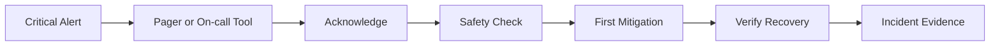

# Responsiveness and Slashing Policy

FP Validated's infrastructure posture is built for institutional delegators: clear alert ownership, bounded response expectations, and an explicit slashing accountability model.

:::info Public policy scope
This page is a public operating policy. It intentionally describes commitments and escalation principles, not private alert routes, on-call identities, internal phone trees, or insurer contract details.
:::

## Responsiveness principles

FP Validated treats validator health alerts as operational commitments, not best-effort notifications.

| Incident class | Examples | Response principle |
| --- | --- | --- |
| Critical signing safety | possible double-sign risk, signer ambiguity, slashing indicator, validator key mismatch | Immediate page; freeze automation and prioritize safety over uptime. |
| Critical liveness | validator down, block production stopped, chain height not progressing for operated validator | Page on-call; begin triage within the critical response window. |
| Degraded service | peer count low, RPC/API degraded, storage pressure, repeated restarts | Alert routed to operator workflow; triage within the standard response window. |
| Observability gap | exporter down, missing labels, scrape target missing, dashboard blind spot | Restore visibility before declaring the workload healthy. |
| Informational | planned maintenance, non-production test environment degradation, known upstream incident | Track in the incident log and communicate if user impact is expected. |

## Response-time targets

FP Validated's target response windows are:

| Severity | Target acknowledgement | Target first action | Notes |
| --- | ---: | ---: | --- |
| SEV0 — signing safety / slashing risk | 15 minutes | 30 minutes | Safety-first. Disable risky automation or signing paths before attempting availability recovery. |
| SEV1 — production validator liveness | 30 minutes | 1 hour | Restore validator health or move into a documented mitigation path. |
| SEV2 — degraded API/RPC/monitoring | 4 hours | 1 business day | Prioritize based on delegator or integration impact. |
| SEV3 — non-production / planned work | 1 business day | Scheduled | Handled through normal change workflow. |

The operating model is compatible with PagerDuty-style paging, Alertmanager routing, chat escalation, or an equivalent on-call tool. The important requirement is not the vendor; it is that critical alerts create a tracked acknowledgement, escalation, and evidence trail.

## Slashing response policy

If slashing is suspected or confirmed, FP Validated follows a safety-first response:

1. **Freeze signing-risk automation** — stop any automated action that could worsen equivocation or duplicate signing risk.
2. **Preserve evidence** — capture validator state, signer topology, relevant alerts, chain evidence, deployment history, and recent changes.
3. **Determine scope** — identify affected validator, chain, epoch/height range, delegator exposure, and whether the event is confirmed on-chain.
4. **Stabilize operations** — keep the validator offline or in safe mode until signer state is unambiguous.
5. **Notify affected parties** — communicate impact, preliminary scope, and next update window.
6. **Publish postmortem summary** — provide a public-safe incident summary once root cause and mitigation are known.

## Delegator compensation posture

For institutional trust, FP Validated's policy target is:

> For delegated assets operated under FP Validated's validator responsibility, FP Validated targets 100% compensation for slashing losses attributable to FP Validated operational fault, funded through FP Validated reserves and/or slashing insurance as available.

This public target has three important boundaries:

| Boundary | Policy |
| --- | --- |
| Covered case | Slashing caused by FP Validated operational fault, signer misconfiguration, infrastructure error, or unsafe deployment process. |
| Excluded case | Protocol-wide bugs, upstream client defects not reasonably preventable, governance-driven penalties, delegator-side action, or force majeure may require separate review. |
| Funding path | FP Validated reserves first where applicable; slashing insurance is a planned/targeted institutional risk-control layer. |

Until formal insurance is active, the public position should say **"insurance planned / targeted"**, not imply an active policy exists.

## Delegation-scale policy

Compensation and insurance planning should scale with delegated value.

| Delegated scale | Required control posture |
| --- | --- |
| Early / small delegation | Public runbook, monitoring, evidence capture, manual signer-safety checks. |
| Material delegation | Formal incident SLA, documented compensation process, internal reserve allocation. |
| Institutional delegation | Insurance or equivalent risk-transfer review, signed operating terms, named escalation path, periodic resilience evidence. |

## Public commitment wording

Use this wording externally:

> FP Validated operates validators with monitored Kubernetes infrastructure, audited GitOps workflows, and a safety-first incident policy. Critical validator and slashing-risk alerts are routed to an on-call workflow with defined response targets. Where slashing is attributable to FP Validated operational fault, our policy target is to make affected delegators whole through FP Validated reserves and/or slashing insurance as the program matures.
