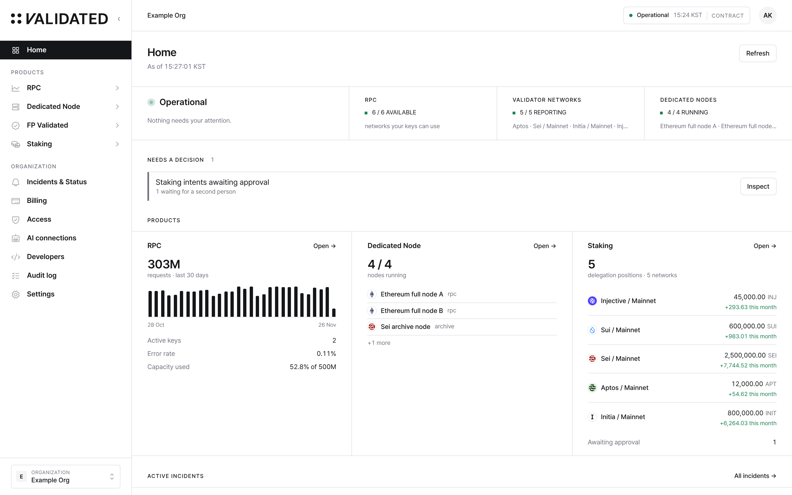
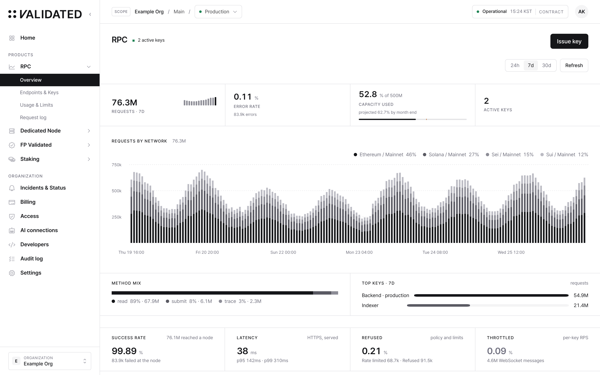
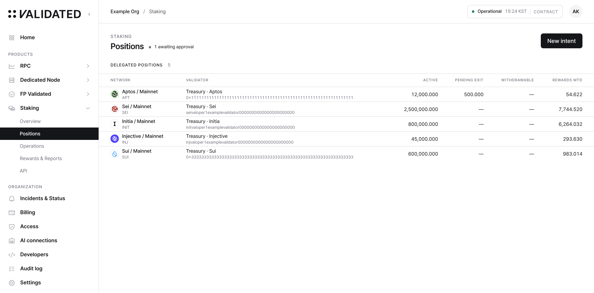
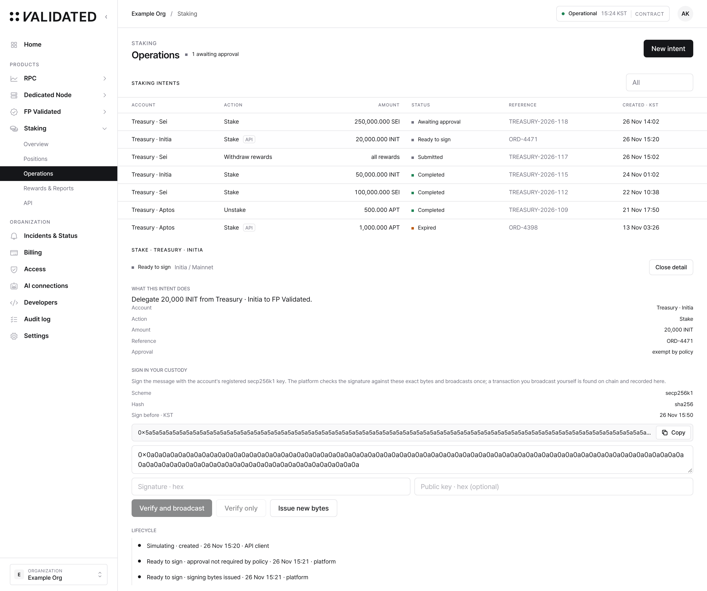
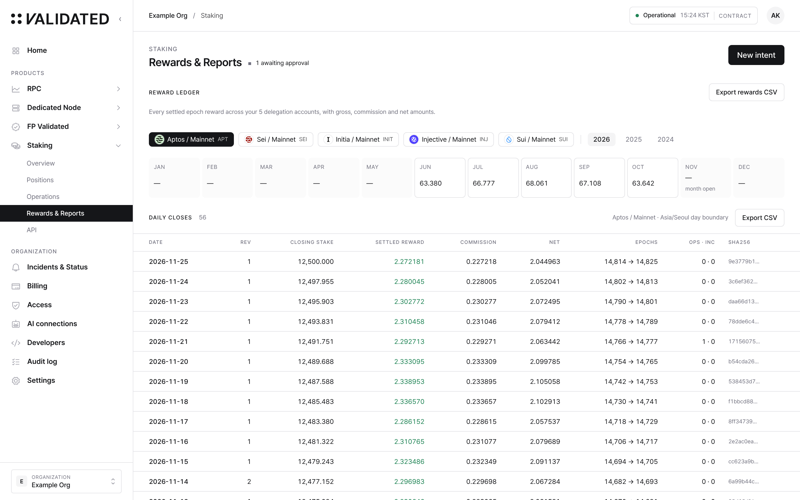

# FP Validated Platform

The FP Validated platform is the console an organization uses to work with our infrastructure: RPC access, dedicated nodes, our validators, and staking. Staking operations can also be created through an API, so a team can use the screens, its own systems, or both.

The screens on this page are examples. They show a sample organization with sample data, not a real customer and not real figures.

## Home

Home answers one question first: does anything need a decision from you. Below that it shows the state of each product the organization uses.

## What the console covers

| Area | What it is for |
| --- | --- |
| RPC | Issue and manage keys, and see usage, limits, errors, and latency by network. |
| Dedicated Node | See the nodes we run for the organization and their state. |
| FP Validated | See the validators we operate on each network. |
| Staking | See positions, create staking operations, and read rewards and reports. |
| Incidents and Status | See current and past incidents that affect the organization. |
| Billing | See the plan, usage against it, and statements. |
| Access and Audit log | Manage members and their permissions, and see who did what. |

## RPC

Usage is shown against the plan, with the split by network and by key, so a team can see where its requests go and how close it is to its limit.

## Staking

### Positions

Positions lists what the organization has delegated to our validators on each network, with pending exits, withdrawable amounts, and rewards for the month.

### Operations

A stake, unstake, or reward withdrawal starts as an intent. The platform prepares the transaction and shows in plain words what it does. The organization signs it with its own key, in its own custody. The platform checks the signature against the exact bytes it issued and broadcasts once.

| Principle | What it means in practice |
| --- | --- |
| The organization keeps its keys. | The platform does not hold the key of the organization's account. It prepares transactions and verifies signatures. |
| An intent can require a second person. | Depending on the organization's policy, an intent waits for approval before it is ready to sign. |
| Every step is recorded. | An intent keeps its history from creation to completion. |
| The same flow through the API. | An intent created by an API client goes through the same checks as one created in the console. |

### Rewards and reports

Rewards are closed daily per network, with the reward, the commission, and the net amount for each day. Monthly totals are shown above the daily closes, and both can be exported.

## Related

- [Staking guides](/staking)
- [FP Validated Infrastructure Overview](/fp-validated-infra/overview)
- [About these docs](/overview/about)
