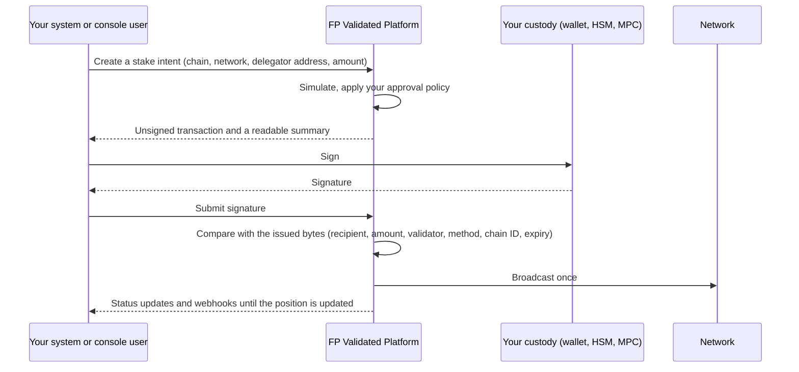

# FP Validated Platform

FP Validated Platform is the console and API that institutions use to work with FP Validated: RPC access, dedicated nodes and non-custodial staking, under one organization with shared roles, approvals, usage records and audit history.

It is built for exchanges, custodians, fintechs and enterprise infrastructure teams that need internal controls and audit evidence, not only an endpoint.

:::info Availability
The platform is offered to onboarded organizations. Supported networks and operations are published per organization through the console and the `GET /v1/staking-networks` catalog, so that list is always the authoritative one. Contact FP Validated to request access.
:::

## What you can do

| Service | What you get | What you no longer have to run |
| --- | --- | --- |
| RPC | One key for several chains and networks, scoped to an environment, with usage you can trace to individual requests | Provider contracts, failover, checking which nodes really support archive or trace calls |
| Dedicated nodes | Nodes reserved for your organization, with health and lag shown against your own baseline | Servers, storage, client upgrades and sync monitoring |
| Staking | Stake, unstake and reward withdrawal on FP Validated validators, with positions and reward statements | Validator operations and handing over custody of assets or keys |

## How organizations are organized

- **Organization → project → environment.** Environments are `development`, `staging` and `production`. Keys, nodes and usage belong to exactly one environment.
- **Isolation.** What a user can see is decided by their sign-in, not by the request. Data from another organization is not visible, including whether it exists.
- **Support access.** FP Validated staff can only act on your organization through a time-boxed support session, and every action they take appears in your audit log.

## Non-custodial staking

The platform never holds signing keys or customer assets. It prepares transactions, checks what you signed, broadcasts once and tracks the result.

- **Intents by action.** You ask for what you want to do (`stake`, `deactivation`, `withdrawal`, `rewards withdrawal`, `restake`) and the platform turns it into the chain's own transaction. Chain differences are returned as data from the catalog instead of a table you maintain.
- **Approvals.** Your organization sets a threshold. Intents below it are ready to sign immediately; intents above it wait for a person to approve in the console. API clients cannot approve.
- **Registered addresses only.** Intents are accepted only for delegator addresses your organization has registered.
- **One broadcast.** The signed bytes must match what the platform issued. A mismatched signer or modified transaction is rejected, and a transaction is never resent automatically.
- **Direct submissions still count.** If you broadcast a signed transaction yourself, the platform finds it on chain and links it to the intent.

### Intent lifecycle

| Status | Meaning |
| --- | --- |
| `SIMULATING` | The transaction is being built and simulated |
| `PENDING_APPROVAL` | Above your policy threshold, waiting for a person to approve |
| `READY_TO_SIGN` | Unsigned transaction issued |
| `SIGNED` | Signature verified, not yet broadcast |
| `SUBMITTED` | Broadcast to the network |
| `CONFIRMED` | Included in a block |
| `COMPLETED` | Reflected in your position |
| `REJECTED`, `CANCELLED`, `EXPIRED`, `FAILED` | Finished without completing |

Every status change is delivered as a signed webhook, in order per intent.

### Positions and rewards

- Balances are reported in four buckets across chains: `staked`, `deactivating`, `withdrawable` and `rewards_withdrawable`, each with the chain height and time it was read.
- Reward records cite the block or event they come from and are kept as double-entry ledger entries.
- Daily and monthly reward closes can be exported for accounting.

## Why validators stay separate from the platform

- Validators keep signing if the platform is unavailable.
- Double-sign protection lives in the validator signing setup and cannot be bypassed from the platform.
- The platform receives only summary metrics from validators, such as uptime, missed signatures and commission.

See [Security Model](/overview/security-model) and [Responsiveness and Slashing Policy](/fp-validated-infra/responsiveness-and-slashing-policy) for the operating commitments behind this.

## Records you can audit

- Every change, its audit record and the event sent to you are written in one transaction.
- Audit records are hash-chained per organization, so tampering is detectable.
- Webhook destinations are checked both when they are registered and when each event is sent.

## Related pages

- [Stake with FP Validated](/staking): per-chain staking guides, including how to stake from your own wallet.
- [Developer](/developer/api-design-principles): API design, authentication and integration patterns.
